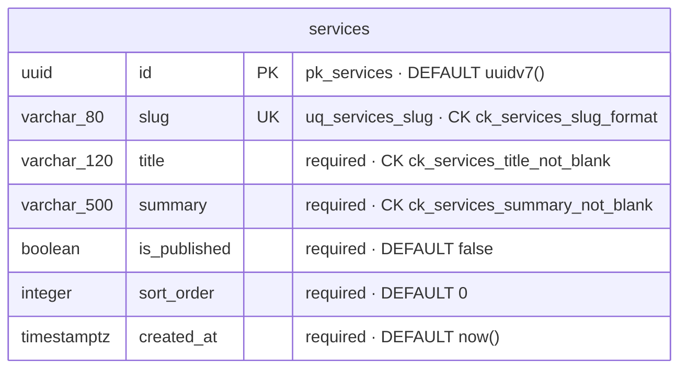
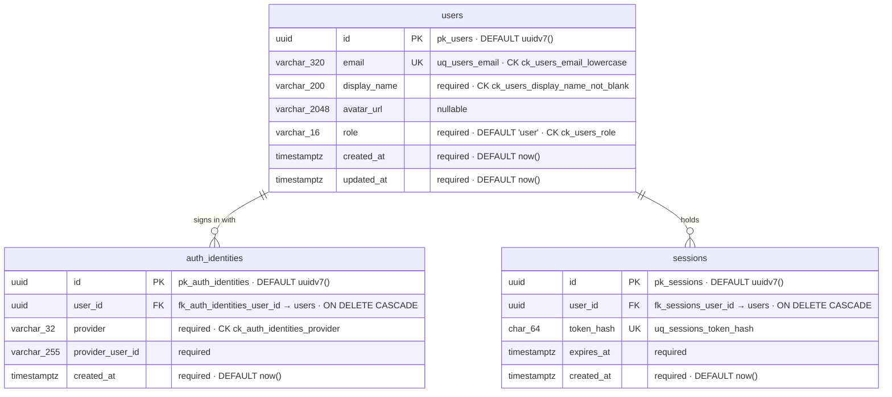
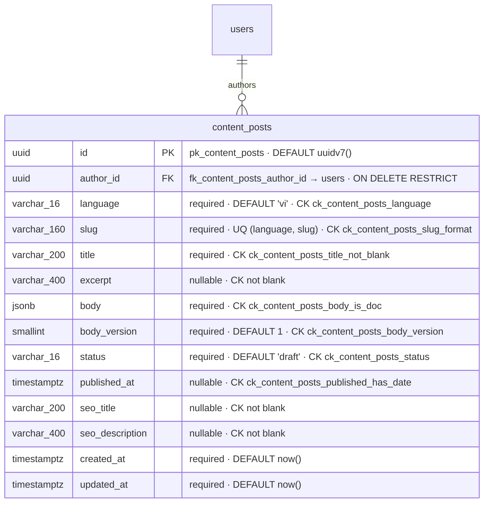
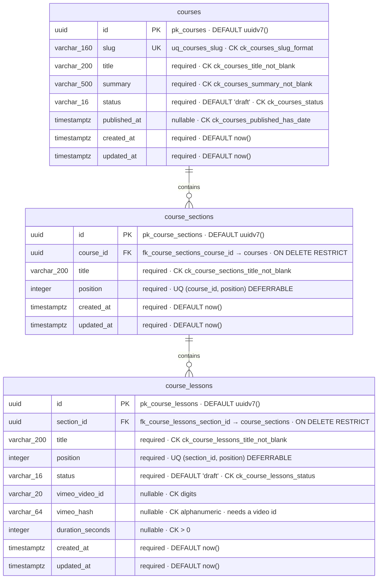

# Database

This document covers **what** our PostgreSQL / TypeORM / migration practice is and **why**.

- Rule wording and classes: `code-rules.md` (cited here by ID).
- Where persistence sits in the app: `architecture.md` §6, §9.
- Which business concepts exist and how they relate: `data-model.md`. **The actual, decided schema:** §12 of this document.
- The order of work for a schema change: the `xuan-database-change` skill.

## 1. Principles

1. **The database is an authority, not a storage bin.** A rule that must always hold ("one row per slug") is enforced by a constraint, so no code path, script or future bug can break it (D31). Application checks are for good error messages; constraints are for truth.
2. **SQL is visible.** We use an ORM, but we read the SQL it generates, both for migrations and for non-trivial queries (D33, D38).
3. **Schema history is code.** Every change is a reviewed, committed migration (I7).
4. **Learn Postgres directly, not only through TypeORM** (§11).

## 2. Naming

| Object          | Convention          | Example                       |
| --------------- | ------------------- | ----------------------------- |
| Table           | snake_case, plural  | `services`, `course_lessons`  |
| Column          | snake_case          | `created_at`                  |
| Entity property | camelCase           | `createdAt`                   |
| Primary key     | `pk_<table>`        | `pk_services`                 |
| Unique          | `uq_<table>_<cols>` | `uq_services_slug`            |
| Foreign key     | `fk_<table>_<col>`  | `fk_course_lessons_course_id` |
| Index           | `ix_<table>_<cols>` | `ix_courses_published_at`     |
| Check           | `ck_<table>_<rule>` | `ck_services_slug_lowercase`  |

**Explicit names** are declared in the entity (`@Entity('services')`, `@Column({ name: 'created_at' })`), with **no custom `NamingStrategy`** (D24). You see every name where it's declared, without first learning a hidden class.

**Constraint names are always explicit** (D25), because:

1. Module code references them by name when translating errors (§9).
2. They show up readably in logs and `\d+`.
3. TypeORM's defaults are hashes (`UQ_8f3e…`) that change unpredictably.

## 3. Primary keys

**Default:** `id uuid PRIMARY KEY DEFAULT uuidv7()` (D26). A different strategy needs a concrete reason (C8).

| Why                       |                                                                                                    |
| ------------------------- | -------------------------------------------------------------------------------------------------- |
| Generated by the database | The database stays the authority. `uuidv7()` is native in PostgreSQL 18, so no extension is needed |
| UUID                      | Matches xuan-web's `id: string`. Not guessable or countable the way `1, 2, 3` is                   |
| v7, not v4                | Time-ordered, so B-tree inserts stay local and the index stays compact                             |
| Accepted cost             | A v7 id reveals its creation time to the millisecond                                               |

A malformed UUID in a path is a validation error, not a 404 (D9).

## 4. Timestamps

- Business records get `created_at timestamptz NOT NULL DEFAULT now()` (D27).
- `updated_at` is added **only when the record changes during its lifecycle** (via `@UpdateDateColumn`). Immutable or insert-only tables don't carry a column that never moves. When the first update path arrives, `updated_at` comes with it in its own migration.
- Real instants are **`timestamptz`** (D28). It stores an absolute moment. `timestamp` without a time zone stores a wall-clock reading that means different things on different servers, which is a classic bug.
- On the wire, instants are ISO 8601 UTC strings.

## 5. Strings and canonical identifiers

- `varchar(n)` where a real maximum exists, `text` otherwise (D29). A limit that matters lives in the database too, not only in Zod.
- **Case-insensitive identifiers** (D30): when a business identifier is _intentionally_ case-insensitive (a URL slug, later a login email), we choose one canonical stored form and the database enforces it. We don't lowercase identifiers in general.

| Option considered                        | Verdict                                                                                                                                                 |
| ---------------------------------------- | ------------------------------------------------------------------------------------------------------------------------------------------------------- |
| `citext`                                 | An extension type; the PostgreSQL docs now steer toward collations                                                                                      |
| Non-deterministic ICU collation          | Correct but advanced                                                                                                                                    |
| `UNIQUE (lower(<col>))` expression index | Every query must remember `lower()`, and TypeORM handles expression indexes poorly                                                                      |
| **Normalize + enforce**                  | **Chosen:** the app writes the canonical form (e.g. lowercase); `CHECK (<col> = lower(<col>))` + `UNIQUE (<col>)` make any other stored form impossible |

## 6. Constraints as authority

| Invariant        | Constraint    |
| ---------------- | ------------- |
| Uniqueness       | `UNIQUE`      |
| Reference exists | `FOREIGN KEY` |
| Value required   | `NOT NULL`    |
| Value allowed    | `CHECK`       |

**Why both app checks and constraints:** Zod produces a good field error, and the constraint guarantees the truth under concurrency, scripts and bugs. Two concurrent "find, then insert" requests both see "not found"; only a constraint stops the duplicate. That's the classic race from the old backend.

### Expected conflicts as normal results

When a conflict is an _expected_ outcome and SQL expresses it clearly, it's handled as a result rather than an exception (C6):

```sql
-- generic illustration, not a decided table
INSERT INTO <table> (<cols>) VALUES (...)
ON CONFLICT ON CONSTRAINT uq_<table>_<cols>
DO NOTHING
```

**The conflict target is always named** (D32). A target-less `ON CONFLICT DO NOTHING` silently absorbs _any_ unique violation, including one from a constraint added years later for a different reason.

TypeORM's `.orIgnore()` produces the target-less form, so an insert that uses `ON CONFLICT` must name its target by another mechanism. The exact TypeORM mechanism is a verification spike (`architecture.md` §16).

## 7. Migrations

**Lifecycle** (D33, I7):

```
change entity ─► migration:generate ─► READ the SQL ─► fix names/defaults if needed ─► migration:run
      ─► inspect in psql (\d+ table) ─► migration:revert ─► migration:run again   (reversible changes, while learning)
```

| Practice                                                                                                                | Why                                                                                                              |
| ----------------------------------------------------------------------------------------------------------------------- | ---------------------------------------------------------------------------------------------------------------- |
| Run by **explicit command only** (locally, test setup, deploy). Never `synchronize`, never `migrationsRun` at boot (I7) | `synchronize` diffs and alters live tables silently, and can drop data. Boot-time migration surprises production |
| **Read the generated SQL** before running it (D33)                                                                      | Generated is not reviewed. The SQL is what actually happens                                                      |
| **One logical change per migration** (D33)                                                                              | It can be reviewed, reverted and understood alone                                                                |
| **Never rewrite** a migration merged or applied anywhere; write a new one (D33)                                         | Other databases already ran the old version. Rewriting it forks history                                          |
| **Meaningful `down()`** when safely reversible (D34)                                                                    | It enables revert practice and local recovery                                                                    |
| **Irreversible changes** (C9): no fake `down()`; document recovery or roll-forward                                      | A misleading rollback is worse than none                                                                         |
| **Generate twice:** the second generate must be empty                                                                   | Proves the entities and the database agree (no phantom diff)                                                     |
| Location `src/database/migrations/` (D35); schema `public`; no extensions in V1                                         | —                                                                                                                |

**Expand → migrate → contract** (C10), when a change would break existing data or running code:

1. **Expand:** add the new column or table, nullable or with a default; deploy code that writes both.
2. **Migrate:** backfill.
3. **Contract:** add `NOT NULL`, drop the old one, once nothing reads it.

Renames, type changes, `NOT NULL` on populated tables and drops are the usual cases.

The CLI's `DataSource` (in `database/`) gets its connection from the same `loadConfig()` as the app (D18). Running it under the ESM starter is a verification spike.

## 8. Transactions

- A transaction is needed **when several writes must succeed or fail together** (C3). A single statement is already atomic.
- **Inside a transaction, use only the transaction's manager** (I8):

```
dataSource.transaction(async (manager) => {
  const orders = manager.getRepository(Order);          ✓ participates
  await this.ordersRepository.insert(...);              ✗ runs OUTSIDE the transaction, on another connection
});
```

**Why:**

- The injected repository uses the connection pool, not the transaction's connection.
- Its writes commit independently, and they survive a rollback.
- This is the most common TypeORM transaction bug, and nothing warns you about it.

## 9. Database errors

**This section owns the facts.** `database/` helpers answer factual questions about a database error; they never assign business meaning (D11, `architecture.md` §9).

| SQLSTATE | Meaning               | Typical constraint |
| -------- | --------------------- | ------------------ |
| `23505`  | unique violation      | `uq_…`             |
| `23503`  | foreign key violation | `fk_…`             |
| `23502`  | not-null violation    | column             |
| `23514`  | check violation       | `ck_…`             |

**Who knows what:**

| Layer              | Knows                                              |
| ------------------ | -------------------------------------------------- |
| `database/` helper | "Is this a unique violation on `uq_courses_slug`?" |
| Owning service     | "…then the slug is taken" → `AppError`             |
| HTTP filter        | Only `AppError` (I15)                              |

An untranslated violation is a bug: 500 + log, never a generic 409 (I15).

**Each translated constraint gets an e2e test** on real Postgres. It proves the constraint name in the code matches the name in the database.

## 10. TypeORM guardrails

| Guardrail                                                                         | Rule | Why                                                                                                                  |
| --------------------------------------------------------------------------------- | ---- | -------------------------------------------------------------------------------------------------------------------- |
| Never pass request input wholesale to persistence                                 | I9   | Mass assignment: one extra field (`role`, `isAdmin`) writes a column nobody meant to expose                          |
| Prefer explicit `insert`/`update`/QueryBuilder over `save()`                      | D36  | `save()` decides INSERT vs UPDATE for you, cascades, and encourages object-graph thinking. That's the Mongoose habit |
| No eager or lazy relations; load explicitly per query                             | D37  | Eager over-fetches everywhere; lazy hides N+1 queries behind property access                                         |
| QueryBuilder/explicit queries where behavior deserves visibility; inspect the SQL | D38  | Know the joins and the query count before production does                                                            |
| Transactions use the manager                                                      | I8   | §8                                                                                                                   |
| Entities never reach the wire                                                     | I10  | `architecture.md` §8                                                                                                 |

## 11. Local PostgreSQL and `psql` practice

**Environment:**

- Docker Compose `postgres:18` on host port **5433**. The native PostgreSQL 12 on 5432 is left untouched.
- Databases `xuan_dev` and `xuan_test`, owned by the login role `xuan_app`. `docker-compose.yml` makes `xuan_app` the image's bootstrap role (`POSTGRES_USER`, a superuser in this local container) and `xuan_dev` its default database. `docker/postgres/init/01-create-test-database.sql` creates `xuan_test` when a fresh volume is first initialized.
- There is no separate `postgres` role in this setup. A non-superuser runtime role is a deployment concern (below).
- Separate migration and runtime roles are deferred to deployment.
- Setup: `development-workflow.md` (Local setup).

**Docker is the local server environment, not a replacement for learning PostgreSQL.**

| Docker hides                                                                              | Docker does not hide                                                                                                                     |
| ----------------------------------------------------------------------------------------- | ---------------------------------------------------------------------------------------------------------------------------------------- |
| Install/upgrade, the Windows service, the data directory, `postgresql.conf`/`pg_hba.conf` | SQL, `psql`, roles, privileges, databases, schemas, constraints, indexes, `EXPLAIN`, transactions, locks, connection strings, migrations |

**Daily practice:**

```
docker compose exec db psql -U xuan_app xuan_dev     # SQL console inside the container (its psql matches the server)
\dt                                                  # tables
\d+ services                                         # columns, defaults, constraints, indexes
SELECT * FROM migrations;                            # what TypeORM has applied
EXPLAIN SELECT … ;                                   # the plan, without executing
```

- **pgAdmin** (optional) connects to `localhost:5433` as `xuan_app`. It's useful for browsing; the console is where the learning happens.
- After every migration: `\d+` the table and check the names, types, defaults and constraints against what you intended.

## 12. Physical database map

The **actual, decided schema**, so the current database can be understood at a glance.

|       | `data-model.md`                                                                           | This section                                                                                        |
| ----- | ----------------------------------------------------------------------------------------- | --------------------------------------------------------------------------------------------------- |
| Shows | Business concepts and their conceptual relationships, including future and undecided ones | Only tables that are **decided** (designed in a slice plan) or **implemented** (a migration exists) |
| Level | No columns, no types                                                                      | Every column, its PostgreSQL type, keys, constraints, important indexes and defaults                |

**Legend:**

| Mark   | Meaning                          |
| ------ | -------------------------------- |
| **PK** | Primary key                      |
| **FK** | Foreign key (→ referenced table) |
| **UQ** | Unique constraint                |
| **CK** | Check constraint                 |
| **IX** | Index                            |

`NOT NULL` is written as _required_. Defaults are shown as written in SQL (`uuidv7()`, `now()`).

**Maintenance:**

- The map changes **in the same change as the migration** that alters the schema.
- Checking it is part of every schema-change review (`development-workflow.md` §8 and the Definition of Done).
- A table appears here once its slice plan settles its columns, marked _decided_. It becomes _implemented_ when its migration runs.
- Nothing is added speculatively for future domains.

### Current schema

| Table      | Status                                                    | Owning module                         | Settled in                                                                      |
| ---------- | --------------------------------------------------------- | ------------------------------------- | ------------------------------------------------------------------------------- |
| `services` | **implemented** 2026-10-14 by migration `CreateServices1791710155502` (owner-approved 2026-10-09; revised 2026-10-11: `duration_minutes` removed). `\d+ services` matches this map on `xuan_dev` and `xuan_test`; revert/run round trip and an empty second `migration:generate` observed on `xuan_test`; invariants proven by `test/services-schema.e2e-spec.ts` | `services` (entity `ServiceOffering`) | `docs/superpowers/plans/2026-10-09-foundation-and-services-catalog.md`, Task 13 |
| `users`, `auth_identities`, `sessions` | **implemented** 2026-10-14 by migration `CreateUsersAndAuth1791980708763` (auth design spec §3). Owner-approved runs: `xuan_test` (guarded run, revert/run round trip, empty second generate) and `xuan_dev`; `\d` matches this map on both; invariants proven by `test/users-schema.e2e-spec.ts` | `users` | `docs/superpowers/plans/2026-10-14-user-auth-and-rbac.md`, Task 2 |
| `content_posts` | **implemented** 2026-10-15 by migration `CreateContentPosts1792001598048` (owner-approved blog design spec §3.2). Owner-approved runs: `xuan_test` (guarded run, revert/run round trip, empty second generate) and `xuan_dev` (empty second generate); `\d+` matches this map on both, cross-module FK included; invariants proven by `test/content-posts-schema.e2e-spec.ts` | `content` (entity `Post`) | `docs/superpowers/plans/2026-10-15-blog-posts.md`, Task 1 |
| `courses`, `course_sections`, `course_lessons` | **decided** 2026-10-18; map owner-approved with the plan (Checkpoint M, 2026-10-19). Not migrated yet | `courses` (entities `Course`, `CourseSection`, `CourseLesson`) | `docs/superpowers/plans/2026-10-18-course-catalog.md`, Task 2 |

#### `services`

One row per offer Xuân provides, shown on Work With Me and the homepage "Ways". It's a **public offer catalog, not an appointment table**. **No price in V1** (money is an open product question). **No duration:** offers aren't all fixed-length sessions (a 90-minute session, a 12-week program), so display copy like "90 minutes" or "12 weeks" doesn't force a numeric column. Explicit display metadata can be added later if the UI needs it.



| Column             | Type           | Required | Default    | Keys / constraints                                          | Why                                                                                                                                                                 |
| ------------------ | -------------- | -------- | ---------- | ----------------------------------------------------------- | ------------------------------------------------------------------------------------------------------------------------------------------------------------------- |
| `id`               | `uuid`         | yes      | `uuidv7()` | **PK** `pk_services`                                        | Identity generated by the database (D26)                                                                                                                            |
| `slug`             | `varchar(80)`  | yes      | —          | **UQ** `uq_services_slug`; **CK** `ck_services_slug_format` | The URL key in `/services/:slug`. Unique, so a URL names one service. The format check is the canonical form (D30)                                                  |
| `title`            | `varchar(120)` | yes      | —          | **CK** `ck_services_title_not_blank`                        | The offer's name. `NOT NULL` alone would still allow `''` or `'   '`                                                                                                |
| `summary`          | `varchar(500)` | yes      | —          | **CK** `ck_services_summary_not_blank`                      | The card/detail description                                                                                                                                         |
| `is_published`     | `boolean`      | yes      | `false`    | —                                                           | Only published services are visible through the public API. Unpublished = draft                                                                                     |
| `sort_order`       | `integer`      | yes      | `0`        | —                                                           | Display order in the catalog (ties broken by `slug`)                                                                                                                |
| `created_at`       | `timestamptz`  | yes      | `now()`    | —                                                           | When the row was created (D27). **No `updated_at` yet.** The only writer is the idempotent seed (`yarn seed:services`): it upserts on `uq_services_slug`, so a re-run updates `title`, `summary`, `is_published` and `sort_order` in place while `id` and `created_at` stay stable. Admin editing comes later                                                 |

**Table-level constraints and indexes:**

| Name                                    | Kind        | Definition                          | Note                                                                                                                                                                                                  |
| --------------------------------------- | ----------- | ----------------------------------- | ----------------------------------------------------------------------------------------------------------------------------------------------------------------------------------------------------- |
| `pk_services`                           | PRIMARY KEY | `(id)`                              | Postgres creates its index automatically                                                                                                                                                              |
| `uq_services_slug`                      | UNIQUE      | `(slug)`                            | Also the index that serves `GET /services/:slug`. The seed's `ON CONFLICT` target (D32)                                                                                                               |
| `ck_services_slug_format`               | CHECK       | `slug ~ '^[a-z0-9]+(-[a-z0-9]+)*$'` | Lowercase kebab-case only: `kickstart-session` ✓, `Kickstart` ✗, `a--b` ✗, `-x` ✗. Makes "lowercase" impossible to violate                                                                            |
| `ck_services_title_not_blank`           | CHECK       | `btrim(title) <> ''`                | Rejects empty and whitespace-only titles                                                                                                                                                              |
| `ck_services_summary_not_blank`         | CHECK       | `btrim(summary) <> ''`              | Same for the summary                                                                                                                                                                                  |
| _(no other index)_                      | —           | —                                   | The catalog is a handful of rows: `WHERE is_published ORDER BY sort_order` is a sequential scan, which is the fastest plan at this size. Add `ix_services_…` only when `EXPLAIN` on real data says so |

**Not in this table:** service applications, appointments and the Google Calendar / Meet integration. They are confirmed future domain concepts (`data-model.md`), but their physical design belongs to the later booking/application slice. They appear here only once that slice's plan settles them.

#### `users`, `auth_identities`, `sessions`

Accounts, how they sign in, and their open sessions (auth design spec, `docs/superpowers/specs/2026-10-14-user-auth-and-rbac-design.md`). One module (`users`) owns all three, so the foreign keys stay inside it (C12 isn't triggered). `users` holds **no provider-specific columns**: Google today and Facebook later are rows in `auth_identities`.



**`users`**

| Column | Type | Required | Default | Keys / constraints | Why |
|---|---|---|---|---|---|
| `id` | `uuid` | yes | `uuidv7()` | **PK** `pk_users` | Every future owner FK points here: `content_posts.author_id`, `service_applications.user_id`, `orders.user_id`, `enrollments.user_id` (D26) |
| `email` | `varchar(320)` | yes | — | **UQ** `uq_users_email`; **CK** `ck_users_email_lowercase` | The verified email, the canonical contact for prefill. One account per email; stored lowercase (D30). 320 = RFC 5321 maximum |
| `display_name` | `varchar(200)` | yes | — | **CK** `ck_users_display_name_not_blank` | Shown in the app and used for prefill. Falls back to the email's local part when Google sends no name |
| `avatar_url` | `varchar(2048)` | no | — | — | The provider's profile picture URL, if any |
| `role` | `varchar(16)` | yes | `'user'` | **CK** `ck_users_role`: `role IN ('user','editor','admin')` | One role per user (design A6). A CHECK, not an enum type, so adding a role is a one-line migration |
| `created_at` | `timestamptz` | yes | `now()` | — | D27 |
| `updated_at` | `timestamptz` | yes | `now()` | — | Rows change: profile sync on sign-in and role changes (D27). Maintained by TypeORM `@UpdateDateColumn` |

**`auth_identities`**

| Column | Type | Required | Default | Keys / constraints | Why |
|---|---|---|---|---|---|
| `id` | `uuid` | yes | `uuidv7()` | **PK** `pk_auth_identities` | — |
| `user_id` | `uuid` | yes | — | **FK** `fk_auth_identities_user_id` → `users(id)` `ON DELETE CASCADE` | An identity has no meaning without its account |
| `provider` | `varchar(32)` | yes | — | **CK** `ck_auth_identities_provider`: `provider IN ('google')` | Facebook later = widen this CHECK |
| `provider_user_id` | `varchar(255)` | yes | — | part of `uq_auth_identities_provider_provider_user_id` | Google's stable `sub`. Never the email: emails change, `sub` doesn't |
| `created_at` | `timestamptz` | yes | `now()` | — | Insert-only rows, so no `updated_at` |

**`sessions`**

| Column | Type | Required | Default | Keys / constraints | Why |
|---|---|---|---|---|---|
| `id` | `uuid` | yes | `uuidv7()` | **PK** `pk_sessions` | — |
| `user_id` | `uuid` | yes | — | **FK** `fk_sessions_user_id` → `users(id)` `ON DELETE CASCADE`; **IX** `ix_sessions_user_id` | Deleting an account ends its sessions; the index serves the cascade and "sign out everywhere" later |
| `token_hash` | `char(64)` | yes | — | **UQ** `uq_sessions_token_hash` | SHA-256 hex of the cookie token. The raw token is never stored, so a database leak can't be replayed as sessions |
| `expires_at` | `timestamptz` | yes | — | — | Absolute expiry (`AUTH_SESSION_TTL_DAYS`). Expired rows are deleted when presented; bulk cleanup is deferred |
| `created_at` | `timestamptz` | yes | `now()` | — | Insert-only |

**Table-level constraints and indexes:**

| Name | Kind | Definition | Note |
|---|---|---|---|
| `uq_auth_identities_provider_provider_user_id` | UNIQUE | `(provider, provider_user_id)` | One account per external identity; the sign-in lookup |
| `uq_auth_identities_user_id_provider` | UNIQUE | `(user_id, provider)` | At most one identity per provider per account; its leading `user_id` also indexes the FK |
| `ix_sessions_user_id` | INDEX | `(user_id)` | FK index for the cascade |
| `uq_sessions_token_hash` | UNIQUE | `(token_hash)` | The per-request session lookup |

#### `content_posts`

Blog posts (blog design spec, `docs/superpowers/specs/2026-10-15-blog-posts-design.md`). Owned by the `content` module. **The first foreign key across modules** (C12, architecture AD14): `author_id` references `users`, declared on the `Post` entity with `@ForeignKey('User', …)` (an entity-name string), so generated migrations keep the constraint while the content module never imports the users module's entity.



| Column | Type | Required | Default | Keys / constraints | Why |
|---|---|---|---|---|---|
| `id` | `uuid` | yes | `uuidv7()` | **PK** `pk_content_posts` | D26 |
| `author_id` | `uuid` | yes | — | **FK** `fk_content_posts_author_id` → `users(id)` `ON DELETE RESTRICT` | Every post has an author (data-model §4). `RESTRICT`: an account with posts can't be deleted by accident (accounts are never deleted today) |
| `language` | `varchar(16)` | yes | `'vi'` | **CK** `ck_content_posts_language`: `language IN ('vi')` | Vietnamese only in V1, i18n-ready (spec B3): adding a language widens the CHECK |
| `slug` | `varchar(160)` | yes | — | **CK** `ck_content_posts_slug_format`: `slug ~ '^[a-z0-9]+(-[a-z0-9]+)*$'`; part of `uq_content_posts_language_slug` | The public URL key, lowercase kebab-case (D30), unique per language. Immutable once the post was ever published (spec B17, enforced by the content service) |
| `title` | `varchar(200)` | yes | — | **CK** `ck_content_posts_title_not_blank` | The page's `<h1>` |
| `excerpt` | `varchar(400)` | no | — | **CK** `ck_content_posts_excerpt_not_blank` | Optional summary; blank input is stored as `NULL`, never `''` |
| `body` | `jsonb` | yes | — | **CK** `ck_content_posts_body_is_doc`: `jsonb_typeof(body) = 'object' AND body->>'type' = 'doc'` | The TipTap/ProseMirror document, validated against the version-1 allow-list by the API (spec §4); the CHECK guards the outer shape |
| `body_version` | `smallint` | yes | `1` | **CK** `ck_content_posts_body_version`: `body_version IN (1)` | Which allow-list the body follows; a new version widens the CHECK |
| `status` | `varchar(16)` | yes | `'draft'` | **CK** `ck_content_posts_status`: `status IN ('draft','published')` | Only published posts are public |
| `published_at` | `timestamptz` | no | — | **CK** `ck_content_posts_published_has_date`: `status <> 'published' OR published_at IS NOT NULL` | The original first-publish instant (spec B16): set once, kept across unpublish/republish |
| `seo_title` | `varchar(200)` | no | — | **CK** `ck_content_posts_seo_title_not_blank` | Optional; the web falls back to the title |
| `seo_description` | `varchar(400)` | no | — | **CK** `ck_content_posts_seo_description_not_blank` | Optional; the web falls back to the excerpt |
| `created_at` | `timestamptz` | yes | `now()` | — | D27 |
| `updated_at` | `timestamptz` | yes | `now()` | — | Posts change (D27); `@UpdateDateColumn`. Idempotent publish/unpublish don't write |

**Table-level constraints and indexes:**

| Name | Kind | Definition | Note |
|---|---|---|---|
| `uq_content_posts_language_slug` | UNIQUE | `(language, slug)` | One post per URL per language; the public lookup. Its violation becomes `409 POST_SLUG_TAKEN` |
| `ix_content_posts_language_status_published_at_id` | INDEX | `(language, status, published_at, id)` | The public list (`WHERE language AND status ORDER BY published_at DESC, id DESC`, scanned backwards) |
| `ix_content_posts_author_id_updated_at_id` | INDEX | `(author_id, updated_at, id)` | The editor's own list (`ORDER BY updated_at DESC, id DESC`) and the FK |

**Not in this table (deferred decisions):** cover/OG images, categories, tags, archive, scheduled publishing, slug redirects, deletion mechanism, preview links (spec §9).

#### `courses`, `course_sections`, `course_lessons`

Self-paced video courses (course platform design spec, `docs/superpowers/specs/2026-10-17-course-platform-design.md` §4). One module (`courses`) owns all three, so both foreign keys stay inside it; there's no cross-module FK in this outcome. An admin authors a course as ordered sections holding ordered lessons; each lesson points to a Vimeo video. Access grants (outcome 2) and progress (outcome 3) arrive with their own outcomes.



**`courses`**

| Column | Type | Required | Default | Keys / constraints | Why |
|---|---|---|---|---|---|
| `id` | `uuid` | yes | `uuidv7()` | **PK** `pk_courses` | D26. Grants (outcome 2) reference it |
| `slug` | `varchar(160)` | yes | — | **UQ** `uq_courses_slug`; **CK** `ck_courses_slug_format`: `slug ~ '^[a-z0-9]+(-[a-z0-9]+)*$'` | The public URL key, lowercase kebab-case (D30). Locked once the course was ever published (spec §10.1, enforced by the courses service). Its violation becomes `409 COURSE_SLUG_TAKEN` |
| `title` | `varchar(200)` | yes | — | **CK** `ck_courses_title_not_blank`: `btrim(title) <> ''` | The course name. The API trims input and rejects blank values first (400); the CHECK is the backstop |
| `summary` | `varchar(500)` | yes | — | **CK** `ck_courses_summary_not_blank`: `btrim(summary) <> ''` | The catalog card text |
| `status` | `varchar(16)` | yes | `'draft'` | **CK** `ck_courses_status`: `status IN ('draft','published')` | Only published courses are public. "Published" means visible, not for sale (spec §10.5). A published course always has ≥ 1 published lesson: no single-row constraint can say that, so the course lock rule L1 holds it (AD15) |
| `published_at` | `timestamptz` | no | — | **CK** `ck_courses_published_has_date`: `status <> 'published' OR published_at IS NOT NULL` | The first-publication instant, kept across unpublish/republish (as posts, B16) |
| `created_at` | `timestamptz` | yes | `now()` | — | D27 |
| `updated_at` | `timestamptz` | yes | `now()` | — | D27; `@UpdateDateColumn`. Orders the admin list. Idempotent publish/unpublish don't write |

**`course_sections`**

| Column | Type | Required | Default | Keys / constraints | Why |
|---|---|---|---|---|---|
| `id` | `uuid` | yes | `uuidv7()` | **PK** `pk_course_sections` | D26 |
| `course_id` | `uuid` | yes | — | **FK** `fk_course_sections_course_id` → `courses(id)` `ON DELETE RESTRICT` | **Immutable**: no endpoint moves a section to another course, so a lesson's course is always its section's. There's no course deletion in V1; `RESTRICT` makes an accidental one fail |
| `title` | `varchar(200)` | yes | — | **CK** `ck_course_sections_title_not_blank`: `btrim(title) <> ''` | — |
| `position` | `integer` | yes | — | **CK** `ck_course_sections_position_not_negative`: `position >= 0`; part of `uq_course_sections_course_id_position` | Curriculum order within the course, `0..n-1` |
| `created_at` | `timestamptz` | yes | `now()` | — | D27 |
| `updated_at` | `timestamptz` | yes | `now()` | — | D27 |

Sections have **no status**: a section is shown publicly only while it holds a published lesson.

**`course_lessons`**

| Column | Type | Required | Default | Keys / constraints | Why |
|---|---|---|---|---|---|
| `id` | `uuid` | yes | `uuidv7()` | **PK** `pk_course_lessons` | The stable identity progress (outcome 3) points to. Reorders and moves never change it |
| `section_id` | `uuid` | yes | — | **FK** `fk_course_lessons_section_id` → `course_sections(id)` `ON DELETE RESTRICT` | Changes only to another section of the **same** course (curriculum order, under the course lock). `RESTRICT` backs the "only empty sections are deleted" rule |
| `title` | `varchar(200)` | yes | — | **CK** `ck_course_lessons_title_not_blank`: `btrim(title) <> ''` | — |
| `position` | `integer` | yes | — | **CK** `ck_course_lessons_position_not_negative`: `position >= 0`; part of `uq_course_lessons_section_id_position` | Order within the section, `0..n-1` |
| `status` | `varchar(16)` | yes | `'draft'` | **CK** `ck_course_lessons_status`: `status IN ('draft','published')` | Draft lessons are invisible outside admin routes |
| `vimeo_video_id` | `varchar(20)` | no | — | **CK** `ck_course_lessons_vimeo_video_id_format`: `vimeo_video_id ~ '^[0-9]{1,20}$'` | The Vimeo video id (spec §8.2). **Never in a public response, never logged** |
| `vimeo_hash` | `varchar(64)` | no | — | **CK** `ck_course_lessons_vimeo_hash_format`: `vimeo_hash ~ '^[A-Za-z0-9]{1,64}$'`; **CK** `ck_course_lessons_hash_needs_video`: `vimeo_hash IS NULL OR vimeo_video_id IS NOT NULL` | The optional privacy hash (`h`), treated like the id |
| `duration_seconds` | `integer` | no | — | **CK** `ck_course_lessons_duration_positive`: `duration_seconds > 0` | Admin-entered and optional (spec §8.3); shown in the outline. The API caps it at 86 400 |
| `created_at` | `timestamptz` | yes | `now()` | — | D27 |
| `updated_at` | `timestamptz` | yes | `now()` | — | D27 |

**Table-level constraints and indexes:**

| Name | Kind | Definition | Note |
|---|---|---|---|
| `uq_courses_slug` | UNIQUE | `(slug)` | One course per URL; the public lookup |
| `uq_course_sections_course_id_position` | UNIQUE **DEFERRABLE INITIALLY DEFERRED** | `(course_id, position)` | Positions are unique per course, checked **at commit**, so a reorder is a run of plain updates in one transaction (spike S7). Its leading `course_id` is also the FK index |
| `uq_course_lessons_section_id_position` | UNIQUE **DEFERRABLE INITIALLY DEFERRED** | `(section_id, position)` | Same for lessons within a section; also the FK index |
| `ck_course_lessons_published_has_video` | CHECK | `status <> 'published' OR vimeo_video_id IS NOT NULL` | A published lesson always has a video (P2). The service refuses first with `409 LESSON_VIDEO_MISSING` |
| _(no other index)_ | — | — | The public list (`WHERE status = 'published' ORDER BY published_at DESC, id DESC`) runs over a handful of rows, as with services. Add an index only when `EXPLAIN` on real data says so |

**TypeORM caveat:** `migration:generate` compares unique constraints **by name only** and doesn't read `condeferrable`. A later change of deferrability on either position unique is invisible to generate and needs a hand-written migration.

**Not in these tables:** price, availability or a "for sale" flag (orders slice, spec §10.5); a language column (additive later); access grants (`course_access_grants`, outcome 2) and progress (`lesson_progress`, outcome 3).
