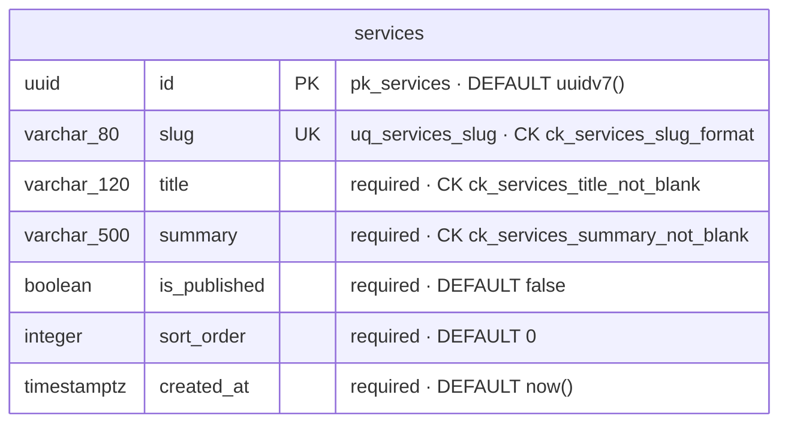
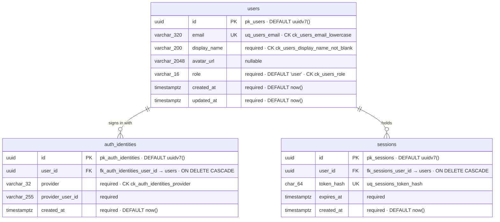
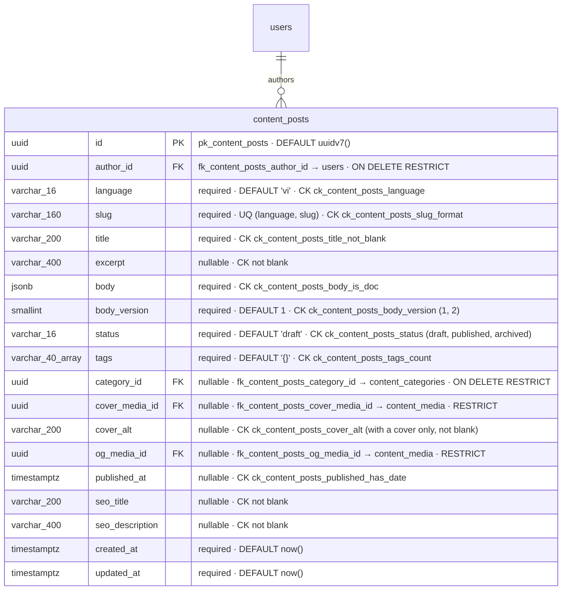
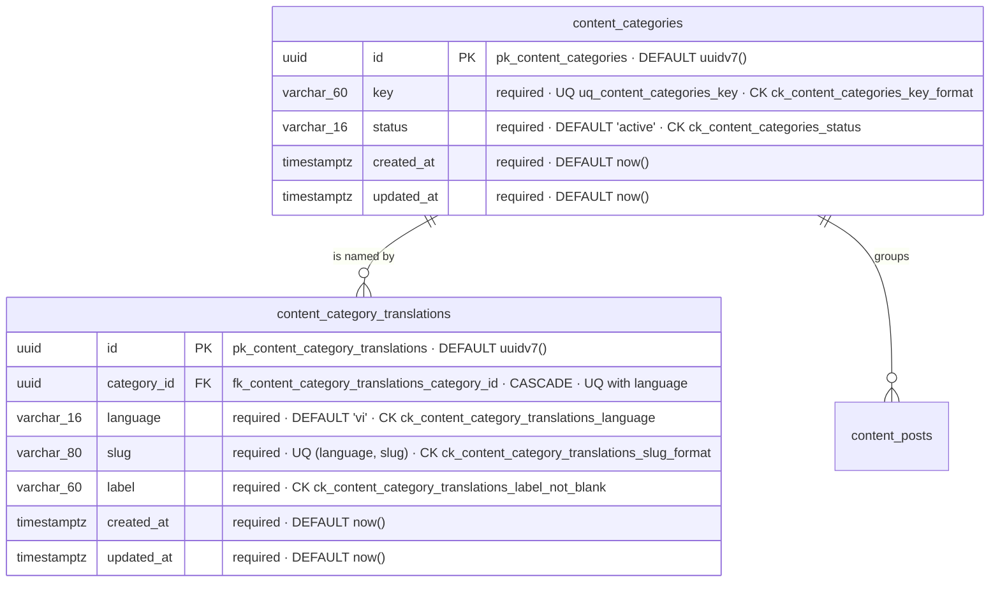
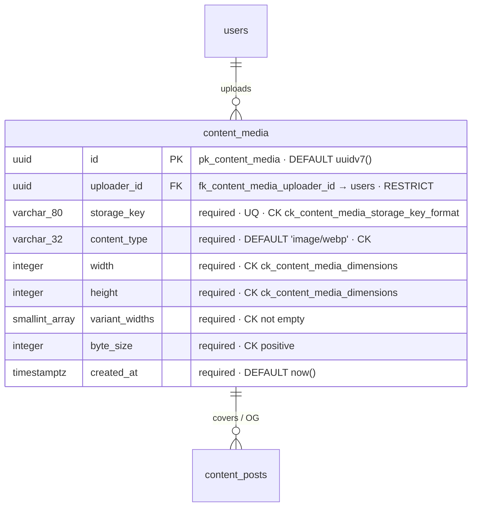
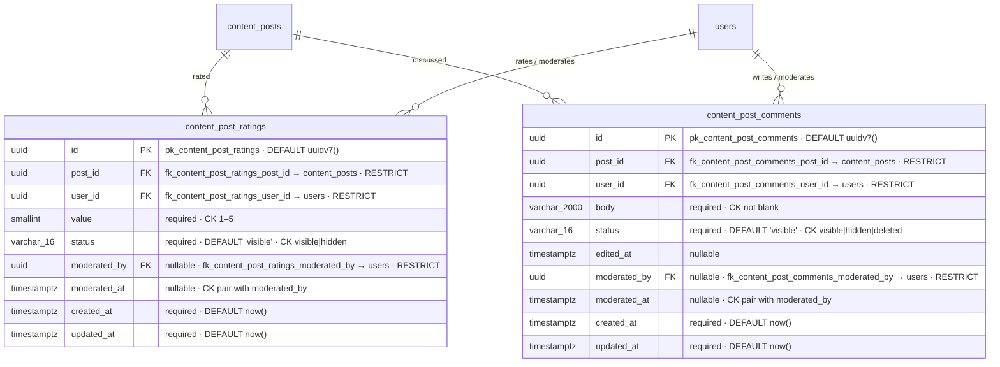
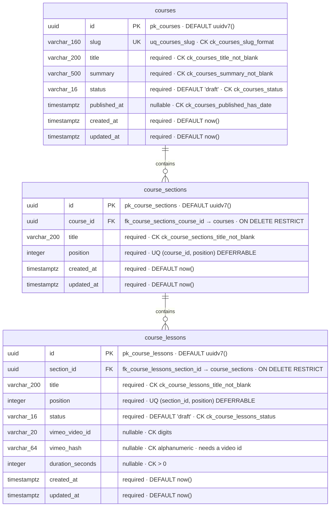
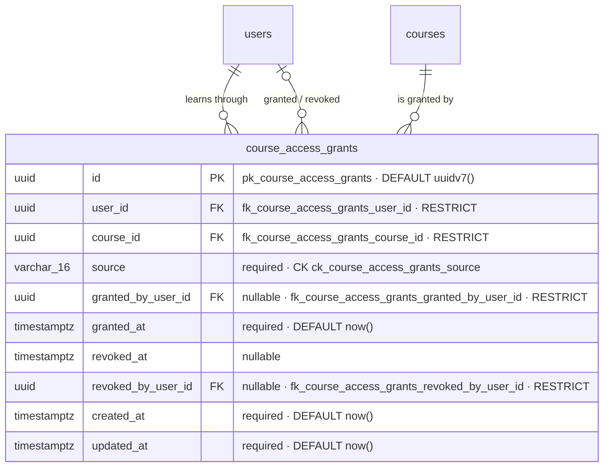
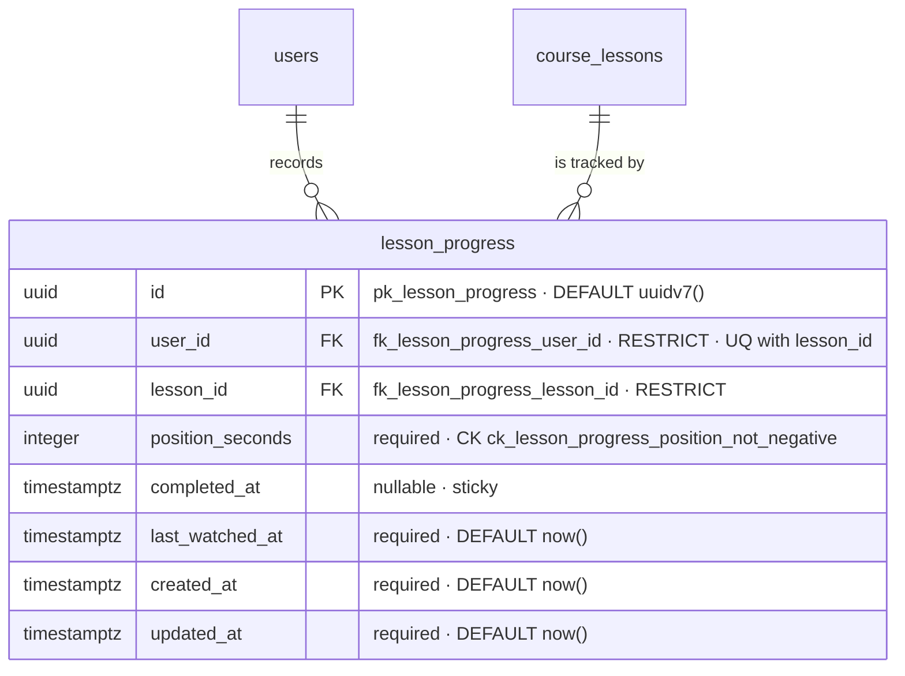

# Database

This document covers **what** our PostgreSQL / TypeORM / migration practice is and **why**.

- Rule wording and classes: `code-rules.md` (cited here by ID).
- Where persistence sits in the app: `architecture.md` §6, §9.
- Which business concepts exist and how they relate: `data-model.md`. **The actual, decided schema:** §12 of this document.
- The order of work for a schema change: the `xuan-database-change` skill.

## 1. Principles

1. **The database is an authority, not a storage bin.** A rule that must always hold ("one row per slug") is enforced by a constraint, so no code path, script or future bug can break it (D31). Application checks are for good error messages; constraints are for truth.
2. **SQL is visible.** We use an ORM, but we read the SQL it generates, both for migrations and for non-trivial queries (D33, D38).
3. **Schema history is code.** Every change is a reviewed, committed migration (I7).
4. **Learn Postgres directly, not only through TypeORM** (§11).

## 2. Naming

| Object          | Convention          | Example                       |
| --------------- | ------------------- | ----------------------------- |
| Table           | snake_case, plural  | `services`, `course_lessons`  |
| Column          | snake_case          | `created_at`                  |
| Entity property | camelCase           | `createdAt`                   |
| Primary key     | `pk_<table>`        | `pk_services`                 |
| Unique          | `uq_<table>_<cols>` | `uq_services_slug`            |
| Foreign key     | `fk_<table>_<col>`  | `fk_course_lessons_course_id` |
| Index           | `ix_<table>_<cols>` | `ix_courses_published_at`     |
| Check           | `ck_<table>_<rule>` | `ck_services_slug_lowercase`  |

**Explicit names** are declared in the entity (`@Entity('services')`, `@Column({ name: 'created_at' })`), with **no custom `NamingStrategy`** (D24). You see every name where it's declared, without first learning a hidden class.

**Constraint names are always explicit** (D25), because:

1. Module code references them by name when translating errors (§9).
2. They show up readably in logs and `\d+`.
3. TypeORM's defaults are hashes (`UQ_8f3e…`) that change unpredictably.

## 3. Primary keys

**Default:** `id uuid PRIMARY KEY DEFAULT uuidv7()` (D26). A different strategy needs a concrete reason (C8).

| Why                       |                                                                                                    |
| ------------------------- | -------------------------------------------------------------------------------------------------- |
| Generated by the database | The database stays the authority. `uuidv7()` is native in PostgreSQL 18, so no extension is needed |
| UUID                      | Matches xuan-web's `id: string`. Not guessable or countable the way `1, 2, 3` is                   |
| v7, not v4                | Time-ordered, so B-tree inserts stay local and the index stays compact                             |
| Accepted cost             | A v7 id reveals its creation time to the millisecond                                               |

A malformed UUID in a path is a validation error, not a 404 (D9).

## 4. Timestamps

- Business records get `created_at timestamptz NOT NULL DEFAULT now()` (D27).
- `updated_at` is added **only when the record changes during its lifecycle** (via `@UpdateDateColumn`). Immutable or insert-only tables don't carry a column that never moves. When the first update path arrives, `updated_at` comes with it in its own migration.
- Real instants are **`timestamptz`** (D28). It stores an absolute moment. `timestamp` without a time zone stores a wall-clock reading that means different things on different servers, which is a classic bug.
- On the wire, instants are ISO 8601 UTC strings.

## 5. Strings and canonical identifiers

- `varchar(n)` where a real maximum exists, `text` otherwise (D29). A limit that matters lives in the database too, not only in Zod.
- **Case-insensitive identifiers** (D30): when a business identifier is _intentionally_ case-insensitive (a URL slug, later a login email), we choose one canonical stored form and the database enforces it. We don't lowercase identifiers in general.

| Option considered                        | Verdict                                                                                                                                                 |
| ---------------------------------------- | ------------------------------------------------------------------------------------------------------------------------------------------------------- |
| `citext`                                 | An extension type; the PostgreSQL docs now steer toward collations                                                                                      |
| Non-deterministic ICU collation          | Correct but advanced                                                                                                                                    |
| `UNIQUE (lower(<col>))` expression index | Every query must remember `lower()`, and TypeORM handles expression indexes poorly                                                                      |
| **Normalize + enforce**                  | **Chosen:** the app writes the canonical form (e.g. lowercase); `CHECK (<col> = lower(<col>))` + `UNIQUE (<col>)` make any other stored form impossible |

## 6. Constraints as authority

| Invariant        | Constraint    |
| ---------------- | ------------- |
| Uniqueness       | `UNIQUE`      |
| Reference exists | `FOREIGN KEY` |
| Value required   | `NOT NULL`    |
| Value allowed    | `CHECK`       |

**Why both app checks and constraints:** Zod produces a good field error, and the constraint guarantees the truth under concurrency, scripts and bugs. Two concurrent "find, then insert" requests both see "not found"; only a constraint stops the duplicate. That's the classic race from the old backend.

### Expected conflicts as normal results

When a conflict is an _expected_ outcome and SQL expresses it clearly, it's handled as a result rather than an exception (C6):

```sql
-- generic illustration, not a decided table
INSERT INTO <table> (<cols>) VALUES (...)
ON CONFLICT ON CONSTRAINT uq_<table>_<cols>
DO NOTHING
```

**The conflict target is always named** (D32). A target-less `ON CONFLICT DO NOTHING` silently absorbs _any_ unique violation, including one from a constraint added years later for a different reason.

TypeORM's `.orIgnore()` produces the target-less form, so an insert that uses `ON CONFLICT` must name its target by another mechanism. The exact TypeORM mechanism is a verification spike (`architecture.md` §16).

## 7. Migrations

**Lifecycle** (D33, I7):

```
change entity ─► migration:generate ─► READ the SQL ─► fix names/defaults if needed ─► migration:run
      ─► inspect in psql (\d+ table) ─► migration:revert ─► migration:run again   (reversible changes, while learning)
```

| Practice                                                                                                                | Why                                                                                                              |
| ----------------------------------------------------------------------------------------------------------------------- | ---------------------------------------------------------------------------------------------------------------- |
| Run by **explicit command only** (locally, test setup, deploy). Never `synchronize`, never `migrationsRun` at boot (I7) | `synchronize` diffs and alters live tables silently, and can drop data. Boot-time migration surprises production |
| **Read the generated SQL** before running it (D33)                                                                      | Generated is not reviewed. The SQL is what actually happens                                                      |
| **One logical change per migration** (D33)                                                                              | It can be reviewed, reverted and understood alone                                                                |
| **Never rewrite** a migration merged or applied anywhere; write a new one (D33)                                         | Other databases already ran the old version. Rewriting it forks history                                          |
| **Meaningful `down()`** when safely reversible (D34)                                                                    | It enables revert practice and local recovery                                                                    |
| **Irreversible changes** (C9): no fake `down()`; document recovery or roll-forward                                      | A misleading rollback is worse than none                                                                         |
| **Generate twice:** the second generate must be empty                                                                   | Proves the entities and the database agree (no phantom diff)                                                     |
| Location `src/database/migrations/` (D35); schema `public`; no extensions in V1                                         | —                                                                                                                |

**Expand → migrate → contract** (C10), when a change would break existing data or running code:

1. **Expand:** add the new column or table, nullable or with a default; deploy code that writes both.
2. **Migrate:** backfill.
3. **Contract:** add `NOT NULL`, drop the old one, once nothing reads it.

Renames, type changes, `NOT NULL` on populated tables and drops are the usual cases.

The CLI's `DataSource` (in `database/`) gets its connection from the same `loadConfig()` as the app (D18). Running it under the ESM starter is a verification spike.

## 8. Transactions

- A transaction is needed **when several writes must succeed or fail together** (C3). A single statement is already atomic.
- **Inside a transaction, use only the transaction's manager** (I8):

```
dataSource.transaction(async (manager) => {
  const orders = manager.getRepository(Order);          ✓ participates
  await this.ordersRepository.insert(...);              ✗ runs OUTSIDE the transaction, on another connection
});
```

**Why:**

- The injected repository uses the connection pool, not the transaction's connection.
- Its writes commit independently, and they survive a rollback.
- This is the most common TypeORM transaction bug, and nothing warns you about it.

## 9. Database errors

**This section owns the facts.** `database/` helpers answer factual questions about a database error; they never assign business meaning (D11, `architecture.md` §9).

| SQLSTATE | Meaning               | Typical constraint |
| -------- | --------------------- | ------------------ |
| `23505`  | unique violation      | `uq_…`             |
| `23503`  | foreign key violation | `fk_…`             |
| `23502`  | not-null violation    | column             |
| `23514`  | check violation       | `ck_…`             |

**Who knows what:**

| Layer              | Knows                                              |
| ------------------ | -------------------------------------------------- |
| `database/` helper | "Is this a unique violation on `uq_courses_slug`?" |
| Owning service     | "…then the slug is taken" → `AppError`             |
| HTTP filter        | Only `AppError` (I15)                              |

An untranslated violation is a bug: 500 + log, never a generic 409 (I15).

**Each translated constraint gets an e2e test** on real Postgres. It proves the constraint name in the code matches the name in the database.

## 10. TypeORM guardrails

| Guardrail                                                                         | Rule | Why                                                                                                                  |
| --------------------------------------------------------------------------------- | ---- | -------------------------------------------------------------------------------------------------------------------- |
| Never pass request input wholesale to persistence                                 | I9   | Mass assignment: one extra field (`role`, `isAdmin`) writes a column nobody meant to expose                          |
| Prefer explicit `insert`/`update`/QueryBuilder over `save()`                      | D36  | `save()` decides INSERT vs UPDATE for you, cascades, and encourages object-graph thinking. That's the Mongoose habit |
| No eager or lazy relations; load explicitly per query                             | D37  | Eager over-fetches everywhere; lazy hides N+1 queries behind property access                                         |
| QueryBuilder/explicit queries where behavior deserves visibility; inspect the SQL | D38  | Know the joins and the query count before production does                                                            |
| Transactions use the manager                                                      | I8   | §8                                                                                                                   |
| Entities never reach the wire                                                     | I10  | `architecture.md` §8                                                                                                 |

## 11. Local PostgreSQL and `psql` practice

**Environment:**

- Docker Compose `postgres:18` on host port **5433**. The native PostgreSQL 12 on 5432 is left untouched.
- Databases `xuan_dev` and `xuan_test`, owned by the login role `xuan_app`. `docker-compose.yml` makes `xuan_app` the image's bootstrap role (`POSTGRES_USER`, a superuser in this local container) and `xuan_dev` its default database. `docker/postgres/init/01-create-test-database.sql` creates `xuan_test` when a fresh volume is first initialized.
- There is no separate `postgres` role in this setup. A non-superuser runtime role is a deployment concern (below).
- Separate migration and runtime roles are deferred to deployment.
- Setup: `development-workflow.md` (Local setup).

**Docker is the local server environment, not a replacement for learning PostgreSQL.**

| Docker hides                                                                              | Docker does not hide                                                                                                                     |
| ----------------------------------------------------------------------------------------- | ---------------------------------------------------------------------------------------------------------------------------------------- |
| Install/upgrade, the Windows service, the data directory, `postgresql.conf`/`pg_hba.conf` | SQL, `psql`, roles, privileges, databases, schemas, constraints, indexes, `EXPLAIN`, transactions, locks, connection strings, migrations |

**Daily practice:**

```
docker compose exec db psql -U xuan_app xuan_dev     # SQL console inside the container (its psql matches the server)
\dt                                                  # tables
\d+ services                                         # columns, defaults, constraints, indexes
SELECT * FROM migrations;                            # what TypeORM has applied
EXPLAIN SELECT … ;                                   # the plan, without executing
```

- **pgAdmin** (optional) connects to `localhost:5433` as `xuan_app`. It's useful for browsing; the console is where the learning happens.
- After every migration: `\d+` the table and check the names, types, defaults and constraints against what you intended.

## 12. Physical database map

The **actual, decided schema**, so the current database can be understood at a glance.

|       | `data-model.md`                                                                           | This section                                                                                        |
| ----- | ----------------------------------------------------------------------------------------- | --------------------------------------------------------------------------------------------------- |
| Shows | Business concepts and their conceptual relationships, including future and undecided ones | Only tables that are **decided** (designed in a slice plan) or **implemented** (a migration exists) |
| Level | No columns, no types                                                                      | Every column, its PostgreSQL type, keys, constraints, important indexes and defaults                |

**Legend:**

| Mark   | Meaning                          |
| ------ | -------------------------------- |
| **PK** | Primary key                      |
| **FK** | Foreign key (→ referenced table) |
| **UQ** | Unique constraint                |
| **CK** | Check constraint                 |
| **IX** | Index                            |

`NOT NULL` is written as _required_. Defaults are shown as written in SQL (`uuidv7()`, `now()`).

**Maintenance:**

- The map changes **in the same change as the migration** that alters the schema.
- Checking it is part of every schema-change review (`development-workflow.md` §8 and the Definition of Done).
- A table appears here once its slice plan settles its columns, marked _decided_. It becomes _implemented_ when its migration runs.
- Nothing is added speculatively for future domains.

### Current schema

| Table      | Status                                                    | Owning module                         | Settled in                                                                      |
| ---------- | --------------------------------------------------------- | ------------------------------------- | ------------------------------------------------------------------------------- |
| `services` | **implemented** 2026-10-14 by migration `CreateServices1791710155502` (owner-approved 2026-10-09; revised 2026-10-11: `duration_minutes` removed). `\d+ services` matches this map on `xuan_dev` and `xuan_test`; revert/run round trip and an empty second `migration:generate` observed on `xuan_test`; invariants proven by `test/services-schema.e2e-spec.ts` | `services` (entity `ServiceOffering`) | `docs/superpowers/plans/2026-10-09-foundation-and-services-catalog.md`, Task 13 |
| `users`, `auth_identities`, `sessions` | **implemented** 2026-10-14 by migration `CreateUsersAndAuth1791980708763` (auth design spec §3). Owner-approved runs: `xuan_test` (guarded run, revert/run round trip, empty second generate) and `xuan_dev`; `\d` matches this map on both; invariants proven by `test/users-schema.e2e-spec.ts` | `users` | `docs/superpowers/plans/2026-10-14-user-auth-and-rbac.md`, Task 2 |
| `content_posts` | **implemented** 2026-10-15 by migration `CreateContentPosts1792001598048` (owner-approved blog design spec §3.2). Owner-approved runs: `xuan_test` (guarded run, revert/run round trip, empty second generate) and `xuan_dev` (empty second generate); `\d+` matches this map on both, cross-module FK included; invariants proven by `test/content-posts-schema.e2e-spec.ts`. **Blog completion B1** (status `archived`, `tags`): migration `AddPostLifecycleAndTags1792398583522`, map recorded under the bounded autonomous execution row (workflow §3.5). **Implemented on `xuan_test` only** (2026-10-19: guarded run, `\d+` matches this map, revert/run round trip, empty second generate; spike S1: `varchar(40)[]` enforces element length). **`xuan_dev` pending in the consolidated owner packet** (protected: it replaces an existing CHECK and adds a column with a default) | `content` (entity `Post`) | `docs/superpowers/plans/2026-10-15-blog-posts.md`, Task 1; B1: `docs/superpowers/plans/2026-10-19-post-lifecycle.md`, Task 1 |
| `courses`, `course_sections`, `course_lessons` | **implemented** 2026-10-19 by migration `CreateCourseCatalog1792343945663` (map owner-approved with the plan, Checkpoint M). Owner-approved runs: `xuan_test` (guarded run, revert/run round trip, empty second generate) and `xuan_dev` (empty second generate; the other tables' schema, rows and contents unchanged); `\d+` matches this map on both, including `DEFERRABLE INITIALLY DEFERRED`; invariants proven by `test/courses-schema.e2e-spec.ts` | `courses` (entities `Course`, `CourseSection`, `CourseLesson`) | `docs/superpowers/plans/2026-10-18-course-catalog.md`, Task 2 |
| `course_access_grants` | **implemented** 2026-10-19 by migration `CreateCourseAccessGrants1792377789142` (map owner-approved with the plan, Checkpoint M). Owner-approved runs: `xuan_test` (Checkpoint A: guarded run, revert/run round trip, empty second generate) and `xuan_dev` (Checkpoint D: empty second generate; the other tables' schema, rows and contents unchanged; no grants created); `\d+` matches this map on both, including the partial unique's `WHERE`; invariants proven by `test/courses-schema.e2e-spec.ts` | `courses` (entity `CourseAccessGrant`) | `docs/superpowers/plans/2026-10-19-course-access.md`, Task 1 |
| `lesson_progress` | **implemented** 2026-10-19 by migration `CreateLessonProgress1792393991146` (map owner-approved with the plan, Checkpoint M). Owner-approved runs: `xuan_test` (Checkpoint A: guarded run, revert/run round trip, empty second generate) and `xuan_dev` (Checkpoint D: empty second generate; the other tables' schema, rows and contents unchanged; no progress rows created); `\d+` matches this map on both, byte-identical; invariants proven by `test/courses-schema.e2e-spec.ts` | `courses` (entity `LessonProgress`) | `docs/superpowers/plans/2026-10-19-course-progress.md`, Task 1 |
| `content_categories`, `content_category_translations` (+ `content_posts.category_id`) | migration `CreatePostCategories1792424947762` (blog completion B2, BD-3); map recorded under the bounded autonomous execution row (workflow §3.5). **Implemented on `xuan_test` only** (2026-10-19: guarded run, `\d+` matches this map, revert/run round trip, empty second generate); invariants proven by `test/content-categories-schema.e2e-spec.ts`. **`xuan_dev` pending in the consolidated owner packet** (protected: B1 is still pending there, and B2 adds an FK to an existing table) | `content` (entities `ContentCategory`, `ContentCategoryTranslation`) | `docs/superpowers/plans/2026-10-19-post-categories.md`, Task 1 |
| `content_media` (+ `content_posts.cover_media_id`, `cover_alt`, `og_media_id`; `body_version` IN (1, 2)) | migration `AddPostMedia1792426532193` (blog completion B3, BD-4/5/10); map recorded under the bounded autonomous execution row (workflow §3.5). **Implemented on `xuan_test` only** (2026-10-27: guarded run, `\d+` matches this map, revert/run round trip, empty second generate); invariants proven by `test/content-media-schema.e2e-spec.ts` and `test/content-posts-schema.e2e-spec.ts`. **`xuan_dev` pending in the consolidated owner packet** (protected: B1 and B2 are still pending there, and B3 adds FKs and a CHECK to an existing table and widens one) | `content` (entity `ContentMedia`) | `docs/superpowers/plans/2026-10-19-post-media.md`, Task 1 |
| `content_post_ratings`, `content_post_comments` | **decided** 2026-10-27 (blog completion B4, BD-6/7/8, Q2); map recorded under the bounded autonomous execution row (workflow §3.5) | `content` (entities `PostRating`, `PostComment`) | `docs/superpowers/plans/2026-10-27-post-discussion.md`, Task 1 |

#### `services`

One row per offer Xuân provides, shown on Work With Me and the homepage "Ways". It's a **public offer catalog, not an appointment table**. **No price in V1** (money is an open product question). **No duration:** offers aren't all fixed-length sessions (a 90-minute session, a 12-week program), so display copy like "90 minutes" or "12 weeks" doesn't force a numeric column. Explicit display metadata can be added later if the UI needs it.



| Column             | Type           | Required | Default    | Keys / constraints                                          | Why                                                                                                                                                                 |
| ------------------ | -------------- | -------- | ---------- | ----------------------------------------------------------- | ------------------------------------------------------------------------------------------------------------------------------------------------------------------- |
| `id`               | `uuid`         | yes      | `uuidv7()` | **PK** `pk_services`                                        | Identity generated by the database (D26)                                                                                                                            |
| `slug`             | `varchar(80)`  | yes      | —          | **UQ** `uq_services_slug`; **CK** `ck_services_slug_format` | The URL key in `/services/:slug`. Unique, so a URL names one service. The format check is the canonical form (D30)                                                  |
| `title`            | `varchar(120)` | yes      | —          | **CK** `ck_services_title_not_blank`                        | The offer's name. `NOT NULL` alone would still allow `''` or `'   '`                                                                                                |
| `summary`          | `varchar(500)` | yes      | —          | **CK** `ck_services_summary_not_blank`                      | The card/detail description                                                                                                                                         |
| `is_published`     | `boolean`      | yes      | `false`    | —                                                           | Only published services are visible through the public API. Unpublished = draft                                                                                     |
| `sort_order`       | `integer`      | yes      | `0`        | —                                                           | Display order in the catalog (ties broken by `slug`)                                                                                                                |
| `created_at`       | `timestamptz`  | yes      | `now()`    | —                                                           | When the row was created (D27). **No `updated_at` yet.** The only writer is the idempotent seed (`yarn seed:services`): it upserts on `uq_services_slug`, so a re-run updates `title`, `summary`, `is_published` and `sort_order` in place while `id` and `created_at` stay stable. Admin editing comes later                                                 |

**Table-level constraints and indexes:**

| Name                                    | Kind        | Definition                          | Note                                                                                                                                                                                                  |
| --------------------------------------- | ----------- | ----------------------------------- | ----------------------------------------------------------------------------------------------------------------------------------------------------------------------------------------------------- |
| `pk_services`                           | PRIMARY KEY | `(id)`                              | Postgres creates its index automatically                                                                                                                                                              |
| `uq_services_slug`                      | UNIQUE      | `(slug)`                            | Also the index that serves `GET /services/:slug`. The seed's `ON CONFLICT` target (D32)                                                                                                               |
| `ck_services_slug_format`               | CHECK       | `slug ~ '^[a-z0-9]+(-[a-z0-9]+)*$'` | Lowercase kebab-case only: `kickstart-session` ✓, `Kickstart` ✗, `a--b` ✗, `-x` ✗. Makes "lowercase" impossible to violate                                                                            |
| `ck_services_title_not_blank`           | CHECK       | `btrim(title) <> ''`                | Rejects empty and whitespace-only titles                                                                                                                                                              |
| `ck_services_summary_not_blank`         | CHECK       | `btrim(summary) <> ''`              | Same for the summary                                                                                                                                                                                  |
| _(no other index)_                      | —           | —                                   | The catalog is a handful of rows: `WHERE is_published ORDER BY sort_order` is a sequential scan, which is the fastest plan at this size. Add `ix_services_…` only when `EXPLAIN` on real data says so |

**Not in this table:** service applications, appointments and the Google Calendar / Meet integration. They are confirmed future domain concepts (`data-model.md`), but their physical design belongs to the later booking/application slice. They appear here only once that slice's plan settles them.

#### `users`, `auth_identities`, `sessions`

Accounts, how they sign in, and their open sessions (auth design spec, `docs/superpowers/specs/2026-10-14-user-auth-and-rbac-design.md`). One module (`users`) owns all three, so the foreign keys stay inside it (C12 isn't triggered). `users` holds **no provider-specific columns**: Google today and Facebook later are rows in `auth_identities`.



**`users`**

| Column | Type | Required | Default | Keys / constraints | Why |
|---|---|---|---|---|---|
| `id` | `uuid` | yes | `uuidv7()` | **PK** `pk_users` | Every future owner FK points here: `content_posts.author_id`, `service_applications.user_id`, `orders.user_id`, `enrollments.user_id` (D26) |
| `email` | `varchar(320)` | yes | — | **UQ** `uq_users_email`; **CK** `ck_users_email_lowercase` | The verified email, the canonical contact for prefill. One account per email; stored lowercase (D30). 320 = RFC 5321 maximum |
| `display_name` | `varchar(200)` | yes | — | **CK** `ck_users_display_name_not_blank` | Shown in the app and used for prefill. Falls back to the email's local part when Google sends no name |
| `avatar_url` | `varchar(2048)` | no | — | — | The provider's profile picture URL, if any |
| `role` | `varchar(16)` | yes | `'user'` | **CK** `ck_users_role`: `role IN ('user','editor','admin')` | One role per user (design A6). A CHECK, not an enum type, so adding a role is a one-line migration |
| `created_at` | `timestamptz` | yes | `now()` | — | D27 |
| `updated_at` | `timestamptz` | yes | `now()` | — | Rows change: profile sync on sign-in and role changes (D27). Maintained by TypeORM `@UpdateDateColumn` |

**`auth_identities`**

| Column | Type | Required | Default | Keys / constraints | Why |
|---|---|---|---|---|---|
| `id` | `uuid` | yes | `uuidv7()` | **PK** `pk_auth_identities` | — |
| `user_id` | `uuid` | yes | — | **FK** `fk_auth_identities_user_id` → `users(id)` `ON DELETE CASCADE` | An identity has no meaning without its account |
| `provider` | `varchar(32)` | yes | — | **CK** `ck_auth_identities_provider`: `provider IN ('google')` | Facebook later = widen this CHECK |
| `provider_user_id` | `varchar(255)` | yes | — | part of `uq_auth_identities_provider_provider_user_id` | Google's stable `sub`. Never the email: emails change, `sub` doesn't |
| `created_at` | `timestamptz` | yes | `now()` | — | Insert-only rows, so no `updated_at` |

**`sessions`**

| Column | Type | Required | Default | Keys / constraints | Why |
|---|---|---|---|---|---|
| `id` | `uuid` | yes | `uuidv7()` | **PK** `pk_sessions` | — |
| `user_id` | `uuid` | yes | — | **FK** `fk_sessions_user_id` → `users(id)` `ON DELETE CASCADE`; **IX** `ix_sessions_user_id` | Deleting an account ends its sessions; the index serves the cascade and "sign out everywhere" later |
| `token_hash` | `char(64)` | yes | — | **UQ** `uq_sessions_token_hash` | SHA-256 hex of the cookie token. The raw token is never stored, so a database leak can't be replayed as sessions |
| `expires_at` | `timestamptz` | yes | — | — | Absolute expiry (`AUTH_SESSION_TTL_DAYS`). Expired rows are deleted when presented; bulk cleanup is deferred |
| `created_at` | `timestamptz` | yes | `now()` | — | Insert-only |

**Table-level constraints and indexes:**

| Name | Kind | Definition | Note |
|---|---|---|---|
| `uq_auth_identities_provider_provider_user_id` | UNIQUE | `(provider, provider_user_id)` | One account per external identity; the sign-in lookup |
| `uq_auth_identities_user_id_provider` | UNIQUE | `(user_id, provider)` | At most one identity per provider per account; its leading `user_id` also indexes the FK |
| `ix_sessions_user_id` | INDEX | `(user_id)` | FK index for the cascade |
| `uq_sessions_token_hash` | UNIQUE | `(token_hash)` | The per-request session lookup |

#### `content_posts`

Blog posts (blog design spec, `docs/superpowers/specs/2026-10-15-blog-posts-design.md`). Owned by the `content` module. **The first foreign key across modules** (C12, architecture AD14): `author_id` references `users`, declared on the `Post` entity with `@ForeignKey('User', …)` (an entity-name string), so generated migrations keep the constraint while the content module never imports the users module's entity.



| Column | Type | Required | Default | Keys / constraints | Why |
|---|---|---|---|---|---|
| `id` | `uuid` | yes | `uuidv7()` | **PK** `pk_content_posts` | D26 |
| `author_id` | `uuid` | yes | — | **FK** `fk_content_posts_author_id` → `users(id)` `ON DELETE RESTRICT` | Every post has an author (data-model §4). `RESTRICT`: an account with posts can't be deleted by accident (accounts are never deleted today) |
| `language` | `varchar(16)` | yes | `'vi'` | **CK** `ck_content_posts_language`: `language IN ('vi')` | Vietnamese only in V1, i18n-ready (spec B3): adding a language widens the CHECK |
| `slug` | `varchar(160)` | yes | — | **CK** `ck_content_posts_slug_format`: `slug ~ '^[a-z0-9]+(-[a-z0-9]+)*$'`; part of `uq_content_posts_language_slug` | The public URL key, lowercase kebab-case (D30), unique per language. Immutable once the post was ever published (spec B17, enforced by the content service) |
| `title` | `varchar(200)` | yes | — | **CK** `ck_content_posts_title_not_blank` | The page's `<h1>` |
| `excerpt` | `varchar(400)` | no | — | **CK** `ck_content_posts_excerpt_not_blank` | Optional summary; blank input is stored as `NULL`, never `''` |
| `body` | `jsonb` | yes | — | **CK** `ck_content_posts_body_is_doc`: `jsonb_typeof(body) = 'object' AND body->>'type' = 'doc'` | The TipTap/ProseMirror document, validated against the version-1 allow-list by the API (spec §4); the CHECK guards the outer shape |
| `body_version` | `smallint` | yes | `1` | **CK** `ck_content_posts_body_version`: `body_version IN (1, 2)` | Which allow-list the body follows. Version 2 (blog completion B3, BD-10) adds images, before/after, rules, code blocks, embeds by id and more marks; the server stores the lowest version the document fits |
| `status` | `varchar(16)` | yes | `'draft'` | **CK** `ck_content_posts_status`: `status IN ('draft','published','archived')` | Only published posts are public. `archived` (blog completion B1, BD-1) retires a post without deleting it; restore returns it to `draft` |
| `tags` | `varchar(40)[]` | yes | `'{}'` | **CK** `ck_content_posts_tags_count`: `cardinality(tags) <= 10` | Up to 10 short labels in the author's order (BD-3). Element length 1–40 is checked by the API (trimmed, no comma, case-insensitive unique); the `varchar(40)` element type is the database backstop (spike S1). No index: V1 has no tag filter |
| `category_id` | `uuid` | no | — | **FK** `fk_content_posts_category_id` → `content_categories(id)` `ON DELETE RESTRICT` | One category per post (BD-3). Nullable: drafts may lack one and legacy published posts keep none; publishing needs one (service rule). `RESTRICT`: a used category can't be deleted (its violation becomes `409 CATEGORY_IN_USE`) |
| `cover_media_id` | `uuid` | no | — | **FK** `fk_content_posts_cover_media_id` → `content_media(id)` `ON DELETE RESTRICT`; `ix_content_posts_cover_media_id` | The cover image (B3). `RESTRICT`: media in use can't vanish (V1 never deletes media) |
| `cover_alt` | `varchar(200)` | no | — | **CK** `ck_content_posts_cover_alt`: `(cover_media_id IS NULL AND cover_alt IS NULL) OR (cover_media_id IS NOT NULL AND cover_alt IS NOT NULL AND btrim(cover_alt) <> '')` (the `IS NOT NULL` matters: `btrim(NULL) <> ''` is NULL, which a CHECK accepts) | Alt text belongs to the placement; a cover always has one |
| `og_media_id` | `uuid` | no | — | **FK** `fk_content_posts_og_media_id` → `content_media(id)` `ON DELETE RESTRICT`; `ix_content_posts_og_media_id` | The social-share image override; the web falls back to the cover |
| `published_at` | `timestamptz` | no | — | **CK** `ck_content_posts_published_has_date`: `status <> 'published' OR published_at IS NOT NULL` | The original first-publish instant (spec B16): set once, kept across unpublish/republish |
| `seo_title` | `varchar(200)` | no | — | **CK** `ck_content_posts_seo_title_not_blank` | Optional; the web falls back to the title |
| `seo_description` | `varchar(400)` | no | — | **CK** `ck_content_posts_seo_description_not_blank` | Optional; the web falls back to the excerpt |
| `created_at` | `timestamptz` | yes | `now()` | — | D27 |
| `updated_at` | `timestamptz` | yes | `now()` | — | Posts change (D27); `@UpdateDateColumn`. Idempotent publish/unpublish don't write |

**Table-level constraints and indexes:**

| Name | Kind | Definition | Note |
|---|---|---|---|
| `uq_content_posts_language_slug` | UNIQUE | `(language, slug)` | One post per URL per language; the public lookup. Its violation becomes `409 POST_SLUG_TAKEN` |
| `ix_content_posts_language_status_published_at_id` | INDEX | `(language, status, published_at, id)` | The public list (`WHERE language AND status ORDER BY published_at DESC, id DESC`, scanned backwards) |
| `ix_content_posts_author_id_updated_at_id` | INDEX | `(author_id, updated_at, id)` | The editor's own list (`ORDER BY updated_at DESC, id DESC`) and the FK |
| `ix_content_posts_category_id_status_published_at_id` | INDEX | `(category_id, status, published_at, id)` | The public category filter and related posts (`WHERE category_id AND status ORDER BY published_at DESC, id DESC`); also the category FK's `RESTRICT` lookup |

**Deletion (B1, BD-1):** only a draft that was never published (`status = 'draft' AND published_at IS NULL`) can be hard-deleted; anything ever published is archived instead. **B1 migration safety:** the wider status CHECK accepts every existing row; the `tags` default is a constant (no table rewrite); `down()` re-narrows the CHECK, so it fails while archived rows exist (roll forward instead, C9).

**B2 migration safety:** two new tables, a nullable column with no default (every existing row stays `NULL`, so the new FK validates nothing) and an index; no existing row changes.

**B3 migration safety:** a new table, three nullable columns with no default, two FKs and a CHECK that every existing row satisfies (all three columns `NULL`), two indexes, and the `body_version` CHECK widened (every stored row is version 1). `down()` re-narrows `body_version`, so it fails while version-2 posts exist (roll forward, C9). A change of `MEDIA_PUBLIC_BASE_URL` after content exists needs a data migration rewriting the URL prefix in bodies (roll forward).

**Not in this table (deferred decisions):** none of the blog completion items, scheduled publishing, slug redirects, preview links.

#### `content_categories`, `content_category_translations`

Blog categories (blog completion spec §4, BD-3), owned by `content`. A category has a stable, immutable **key** (internal) and, per language, a **slug** (the `?category=` value) and a **label**. V1 stores `vi` rows only; English adds rows, not columns. Admin-only management; a used category is archived, never deleted.



| Table.column | Type | Required | Default | Keys / constraints | Why |
|---|---|---|---|---|---|
| `content_categories.id` | `uuid` | yes | `uuidv7()` | **PK** `pk_content_categories` | D26 |
| `content_categories.key` | `varchar(60)` | yes | — | **UQ** `uq_content_categories_key`; **CK** `ck_content_categories_key_format`: `key ~ '^[a-z0-9]+(-[a-z0-9]+)*$'` | Stable identity, lowercase kebab (D30), never changed by the API |
| `content_categories.status` | `varchar(16)` | yes | `'active'` | **CK** `ck_content_categories_status`: `status IN ('active','archived')` | Archived categories leave the public list and filter; their posts stay |
| `content_categories.created_at`, `updated_at` | `timestamptz` | yes | `now()` | — | D27 |
| `content_category_translations.id` | `uuid` | yes | `uuidv7()` | **PK** `pk_content_category_translations` | D26 |
| `content_category_translations.category_id` | `uuid` | yes | — | **FK** `fk_content_category_translations_category_id` → `content_categories(id)` `ON DELETE CASCADE`; leads `uq_content_category_translations_category_id_language` | A translation has no life of its own; deleting a category is already restricted to unused ones |
| `content_category_translations.language` | `varchar(16)` | yes | `'vi'` | **CK** `ck_content_category_translations_language`: `language IN ('vi')` | As posts (B3b): widening it is the i18n change |
| `content_category_translations.slug` | `varchar(80)` | yes | — | **CK** `ck_content_category_translations_slug_format` (kebab); part of `uq_content_category_translations_language_slug` | The public filter value, unique per language; editable (a filter, not a content URL) |
| `content_category_translations.label` | `varchar(60)` | yes | — | **CK** `ck_content_category_translations_label_not_blank`: `btrim(label) <> ''` | Display name |
| `content_category_translations.created_at`, `updated_at` | `timestamptz` | yes | `now()` | — | D27 |

| Name | Kind | Definition | Note |
|---|---|---|---|
| `uq_content_categories_key` | UNIQUE | `(key)` | Its violation becomes `409 CATEGORY_KEY_TAKEN` |
| `uq_content_category_translations_language_slug` | UNIQUE | `(language, slug)` | The public lookup; its violation becomes `409 CATEGORY_SLUG_TAKEN` |
| `uq_content_category_translations_category_id_language` | UNIQUE | `(category_id, language)` | One name per language; also serves the FK |

#### `content_media`

Uploaded blog images (blog completion spec §5.2, BD-5), owned by `content`. One row per upload; the files are WebP variants at `<storage_key>-<width>.webp` in the configured storage (local folder in development, Cloudflare R2 in production). Rows never change and are never deleted in V1 (orphans kept, BD-5).



| Column | Type | Required | Default | Keys / constraints | Why |
|---|---|---|---|---|---|
| `id` | `uuid` | yes | `uuidv7()` | **PK** `pk_content_media` | D26 |
| `uploader_id` | `uuid` | yes | — | **FK** `fk_content_media_uploader_id` → `users(id)` `ON DELETE RESTRICT` (by entity name, AD14); `ix_content_media_uploader_id` | Who uploaded it (BD-11); a later media library applies ownership to management |
| `storage_key` | `varchar(80)` | yes | — | **UQ** `uq_content_media_storage_key`; **CK** `ck_content_media_storage_key_format`: `storage_key ~ '^blog/[0-9a-f-]{36}$'` | A random key: the original filename never reaches storage or URLs |
| `content_type` | `varchar(32)` | yes | `'image/webp'` | **CK** `ck_content_media_content_type`: `content_type IN ('image/webp')` | Every variant is re-encoded to WebP |
| `width`, `height` | `integer` | yes | — | **CK** `ck_content_media_dimensions`: both 1–6000 | Of the largest variant (layout without shift) |
| `variant_widths` | `smallint[]` | yes | — | **CK** `ck_content_media_variant_widths_not_empty`: `cardinality(variant_widths) >= 1` | Which `<key>-<width>.webp` files exist (640/1280/1920, or one smaller width) |
| `byte_size` | `integer` | yes | — | **CK** `ck_content_media_byte_size_positive`: `byte_size > 0` | Total stored bytes, for a later cleanup or quota |
| `created_at` | `timestamptz` | yes | `now()` | — | No `updated_at`: the row never changes (D27) |

#### `content_post_ratings`, `content_post_comments`

Reader discussion on published posts (blog completion spec §6, BD-6/7/8, Q2), owned by `content`. Ratings and comments are **independent**: either exists without the other. Rows are never hard-deleted in V1; moderation and the author's own deletion change `status`.

**Invariants:** one rating per user per post, whatever its status; a rating is 1–5; a comment is never blank; moderation records who **and** when, or neither.



**`content_post_ratings`:**

| Column | Type | Required | Default | Keys / constraints | Why |
|---|---|---|---|---|---|
| `id` | `uuid` | yes | `uuidv7()` | **PK** `pk_content_post_ratings` | D26 |
| `post_id` | `uuid` | yes | — | **FK** `fk_content_post_ratings_post_id` → `content_posts(id)` `ON DELETE RESTRICT`; served by the unique below | A post with discussion is never deleted (only never-published drafts are, §3.1) |
| `user_id` | `uuid` | yes | — | **FK** `fk_content_post_ratings_user_id` → `users(id)` `ON DELETE RESTRICT` (by entity name, AD14); **IX** `ix_content_post_ratings_user_id` | The rater; "my rating" and a later account export |
| `value` | `smallint` | yes | — | **CK** `ck_content_post_ratings_value`: `value BETWEEN 1 AND 5` | Stars |
| `status` | `varchar(16)` | yes | `'visible'` | **CK** `ck_content_post_ratings_status`: `status IN ('visible', 'hidden')` | Ratings are hidden and restored, never deleted (Q2); hidden ones leave the summary |
| `moderated_by` | `uuid` | no | — | **FK** `fk_content_post_ratings_moderated_by` → `users(id)` `ON DELETE RESTRICT` | The admin of the last real transition. No index: nothing queries by moderator, and users are never deleted in V1 |
| `moderated_at` | `timestamptz` | no | — | **CK** `ck_content_post_ratings_moderation_pair`: `(moderated_by IS NULL) = (moderated_at IS NULL)` | Who and when travel together |
| `created_at`, `updated_at` | `timestamptz` | yes | `now()` | — | D27; `updated_at` moves on a re-rating and on a real transition only |

| Key | Kind | Columns | Why |
|---|---|---|---|
| `uq_content_post_ratings_post_id_user_id` | UNIQUE | `(post_id, user_id)` | One per user per post **regardless of status** (BD-6); the upsert's named target (D32); leads with `post_id`, so it serves the summary and the post FK |

**`content_post_comments`:**

| Column | Type | Required | Default | Keys / constraints | Why |
|---|---|---|---|---|---|
| `id` | `uuid` | yes | `uuidv7()` | **PK** `pk_content_post_comments` | D26 |
| `post_id` | `uuid` | yes | — | **FK** `fk_content_post_comments_post_id` → `content_posts(id)` `ON DELETE RESTRICT`; served by the list index below | As ratings |
| `user_id` | `uuid` | yes | — | **FK** `fk_content_post_comments_user_id` → `users(id)` `ON DELETE RESTRICT`; **IX** `ix_content_post_comments_user_id` | The author; "my comments" |
| `body` | `varchar(2000)` | yes | — | **CK** `ck_content_post_comments_body_not_blank`: `body ~ '[^[:space:]]'` (at least one non-whitespace character; `btrim()` alone strips spaces only, so a body of newlines would pass) | Plain text. The API trims, normalizes `\r\n` and counts code points; `varchar(n)` counts characters too |
| `status` | `varchar(16)` | yes | `'visible'` | **CK** `ck_content_post_comments_status`: `status IN ('visible', 'hidden', 'deleted')` | `deleted` is terminal for everyone (Q2) |
| `edited_at` | `timestamptz` | no | — | — | Set by the author's edit only, never by moderation |
| `moderated_by`, `moderated_at` | `uuid`, `timestamptz` | no | — | **FK** `fk_content_post_comments_moderated_by` → `users(id)` `ON DELETE RESTRICT`; **CK** `ck_content_post_comments_moderation_pair` | As ratings |
| `created_at`, `updated_at` | `timestamptz` | yes | `now()` | — | D27 |

| Key | Kind | Columns | Why |
|---|---|---|---|
| `ix_content_post_comments_post_id_status_created_at_id` | INDEX | `(post_id, status, created_at, id)` | The public list: a post's visible comments, oldest first, with a stable tie-break; also the post FK index |

**B4 migration safety:** two new tables and their indexes and FKs; no existing row or constraint changes. On `xuan_dev` it is still **protected** while B1–B3 are pending there (workflow §3.5). `down()` drops both tables, discarding any discussion (a deliberate, documented loss; roll forward once discussion exists, C9).

#### `courses`, `course_sections`, `course_lessons`

Self-paced video courses (course platform design spec, `docs/superpowers/specs/2026-10-17-course-platform-design.md` §4). One module (`courses`) owns all three, so both foreign keys stay inside it; there's no cross-module FK in this outcome. An admin authors a course as ordered sections holding ordered lessons; each lesson points to a Vimeo video. Access grants (outcome 2) and progress (outcome 3) arrive with their own outcomes.



**`courses`**

| Column | Type | Required | Default | Keys / constraints | Why |
|---|---|---|---|---|---|
| `id` | `uuid` | yes | `uuidv7()` | **PK** `pk_courses` | D26. Grants (outcome 2) reference it |
| `slug` | `varchar(160)` | yes | — | **UQ** `uq_courses_slug`; **CK** `ck_courses_slug_format`: `slug ~ '^[a-z0-9]+(-[a-z0-9]+)*$'` | The public URL key, lowercase kebab-case (D30). Locked once the course was ever published (spec §10.1, enforced by the courses service). Its violation becomes `409 COURSE_SLUG_TAKEN` |
| `title` | `varchar(200)` | yes | — | **CK** `ck_courses_title_not_blank`: `btrim(title) <> ''` | The course name. The API trims input and rejects blank values first (400); the CHECK is the backstop |
| `summary` | `varchar(500)` | yes | — | **CK** `ck_courses_summary_not_blank`: `btrim(summary) <> ''` | The catalog card text |
| `status` | `varchar(16)` | yes | `'draft'` | **CK** `ck_courses_status`: `status IN ('draft','published')` | Only published courses are public. "Published" means visible, not for sale (spec §10.5). A published course always has ≥ 1 published lesson: no single-row constraint can say that, so the course lock rule L1 holds it (AD15) |
| `published_at` | `timestamptz` | no | — | **CK** `ck_courses_published_has_date`: `status <> 'published' OR published_at IS NOT NULL` | The first-publication instant, kept across unpublish/republish (as posts, B16) |
| `created_at` | `timestamptz` | yes | `now()` | — | D27 |
| `updated_at` | `timestamptz` | yes | `now()` | — | D27; `@UpdateDateColumn`. The latest meaningful change to the course **or its curriculum**: every section or lesson create, edit, (un)publish, delete and real reorder also sets it, under the course lock (L1). No-op writes (identical content, idempotent (un)publish, an unchanged order) and refused changes don't. Learner progress and access grants never will. Orders the admin list |

**`course_sections`**

| Column | Type | Required | Default | Keys / constraints | Why |
|---|---|---|---|---|---|
| `id` | `uuid` | yes | `uuidv7()` | **PK** `pk_course_sections` | D26 |
| `course_id` | `uuid` | yes | — | **FK** `fk_course_sections_course_id` → `courses(id)` `ON DELETE RESTRICT` | **Immutable**: no endpoint moves a section to another course, so a lesson's course is always its section's. There's no course deletion in V1; `RESTRICT` makes an accidental one fail |
| `title` | `varchar(200)` | yes | — | **CK** `ck_course_sections_title_not_blank`: `btrim(title) <> ''` | — |
| `position` | `integer` | yes | — | **CK** `ck_course_sections_position_not_negative`: `position >= 0`; part of `uq_course_sections_course_id_position` | Curriculum order within the course, `0..n-1` |
| `created_at` | `timestamptz` | yes | `now()` | — | D27 |
| `updated_at` | `timestamptz` | yes | `now()` | — | D27 |

Sections have **no status**: a section is shown publicly only while it holds a published lesson.

**`course_lessons`**

| Column | Type | Required | Default | Keys / constraints | Why |
|---|---|---|---|---|---|
| `id` | `uuid` | yes | `uuidv7()` | **PK** `pk_course_lessons` | The stable identity progress (outcome 3) points to. Reorders and moves never change it |
| `section_id` | `uuid` | yes | — | **FK** `fk_course_lessons_section_id` → `course_sections(id)` `ON DELETE RESTRICT` | Changes only to another section of the **same** course (curriculum order, under the course lock). `RESTRICT` backs the "only empty sections are deleted" rule |
| `title` | `varchar(200)` | yes | — | **CK** `ck_course_lessons_title_not_blank`: `btrim(title) <> ''` | — |
| `position` | `integer` | yes | — | **CK** `ck_course_lessons_position_not_negative`: `position >= 0`; part of `uq_course_lessons_section_id_position` | Order within the section, `0..n-1` |
| `status` | `varchar(16)` | yes | `'draft'` | **CK** `ck_course_lessons_status`: `status IN ('draft','published')` | Draft lessons are invisible outside admin routes |
| `vimeo_video_id` | `varchar(20)` | no | — | **CK** `ck_course_lessons_vimeo_video_id_format`: `vimeo_video_id ~ '^[0-9]{1,20}$'` | The Vimeo video id (spec §8.2). **Never in a public response, never logged** |
| `vimeo_hash` | `varchar(64)` | no | — | **CK** `ck_course_lessons_vimeo_hash_format`: `vimeo_hash ~ '^[A-Za-z0-9]{1,64}$'`; **CK** `ck_course_lessons_hash_needs_video`: `vimeo_hash IS NULL OR vimeo_video_id IS NOT NULL` | The optional privacy hash (`h`), treated like the id |
| `duration_seconds` | `integer` | no | — | **CK** `ck_course_lessons_duration_positive`: `duration_seconds > 0` | Admin-entered and optional (spec §8.3); shown in the outline. The API caps it at 86 400 |
| `created_at` | `timestamptz` | yes | `now()` | — | D27 |
| `updated_at` | `timestamptz` | yes | `now()` | — | D27 |

**Table-level constraints and indexes:**

| Name | Kind | Definition | Note |
|---|---|---|---|
| `uq_courses_slug` | UNIQUE | `(slug)` | One course per URL; the public lookup |
| `uq_course_sections_course_id_position` | UNIQUE **DEFERRABLE INITIALLY DEFERRED** | `(course_id, position)` | Positions are unique per course, checked **at commit**, so a reorder is a run of plain updates in one transaction (spike S7). Its leading `course_id` is also the FK index |
| `uq_course_lessons_section_id_position` | UNIQUE **DEFERRABLE INITIALLY DEFERRED** | `(section_id, position)` | Same for lessons within a section; also the FK index |
| `ck_course_lessons_published_has_video` | CHECK | `status <> 'published' OR vimeo_video_id IS NOT NULL` | A published lesson always has a video (P2). The service refuses first with `409 LESSON_VIDEO_MISSING` |
| _(no other index)_ | — | — | The public list (`WHERE status = 'published' ORDER BY published_at DESC, id DESC`) runs over a handful of rows, as with services. Add an index only when `EXPLAIN` on real data says so |

**TypeORM caveat:** `migration:generate` compares unique constraints **by name only** and doesn't read `condeferrable`. A later change of deferrability on either position unique is invisible to generate and needs a hand-written migration.

**Not in these tables:** price, availability or a "for sale" flag (orders slice, spec §10.5); a language column (additive later); access grants (`course_access_grants`) and progress (`lesson_progress`), below.

#### `course_access_grants`

Who may learn a course (course platform design spec §5, OD-1). **One row per grant, not one per (user, course):** access ⇔ at least one row for (user, course) with `revoked_at IS NULL`. A revocation closes its row and keeps it as history; restoring access inserts a new row. This keeps a future refund of a purchase grant from cutting off an unrelated complimentary grant (spec §5.1). Three FKs reach `users`, declared by entity name with no relation (AD14). The course FK stays inside the module.



| Column | Type | Required | Default | Keys / constraints | Why |
|---|---|---|---|---|---|
| `id` | `uuid` | yes | `uuidv7()` | **PK** `pk_course_access_grants` | One row per grant (OD-1) |
| `user_id` | `uuid` | yes | — | **FK** `fk_course_access_grants_user_id` → `users(id)` `ON DELETE RESTRICT` (by entity name, AD14) | The learner. An unknown user's violation becomes `404 NOT_FOUND` |
| `course_id` | `uuid` | yes | — | **FK** `fk_course_access_grants_course_id` → `courses(id)` `ON DELETE RESTRICT` | Any status: testers can be granted before publication. An unknown course's violation becomes `404 NOT_FOUND` |
| `source` | `varchar(16)` | yes | — | **CK** `ck_course_access_grants_source`: `source IN ('admin')` | Only value in V1; the orders slice widens it to `'purchase'` (spec §5.4). No default: every writer names its source |
| `granted_by_user_id` | `uuid` | no | — | **FK** `fk_course_access_grants_granted_by_user_id` → `users(id)` `ON DELETE RESTRICT`; **CK** `ck_course_access_grants_admin_has_granter`: `source <> 'admin' OR granted_by_user_id IS NOT NULL` | Who granted. A future purchase grant has none |
| `granted_at` | `timestamptz` | yes | `now()` | — | Shown in the grant history; never changes |
| `revoked_at` | `timestamptz` | no | — | **CK** `ck_course_access_grants_revocation_pair`: `(revoked_at IS NULL) = (revoked_by_user_id IS NULL)` | `NULL` = active |
| `revoked_by_user_id` | `uuid` | no | — | **FK** `fk_course_access_grants_revoked_by_user_id` → `users(id)` `ON DELETE RESTRICT` | Who revoked |
| `created_at` | `timestamptz` | yes | `now()` | — | D27 |
| `updated_at` | `timestamptz` | yes | `now()` | — | D27; `@UpdateDateColumn`. Set by a revocation **and by a repeated grant**: the grant upsert's `DO UPDATE` must name a column (spike S8), so a repeated grant is business-idempotent (same row, `id` and `granted_at`; same DTO) but not a database no-op. Not on the wire |

**Table-level constraints and indexes:**

| Name | Kind | Definition | Note |
|---|---|---|---|
| `uq_course_access_grants_user_id_course_id_active_admin` | UNIQUE **partial** index | `(user_id, course_id) WHERE source = 'admin' AND revoked_at IS NULL` | At most one active admin grant per (user, course) (CP5). The grant upsert's `ON CONFLICT (user_id, course_id) WHERE …` target (D32, C6). Named with a predicate suffix: a plain `uq_<table>_<cols>` would suggest a full unique (spec §21) |
| `ix_course_access_grants_user_id_course_id` | INDEX | `(user_id, course_id)` | The access check (`EXISTS … revoked_at IS NULL`, any source), `GET /learn/courses` and the user FK |
| _(no other index)_ | — | — | The admin grant list (`WHERE course_id ORDER BY granted_at DESC, id DESC`) runs over a handful of rows, and no course or user is ever deleted in V1. Add one when `EXPLAIN` on real data says so |

**TypeORM caveat (spike S8):** `migration:generate` compares indexes by name, uniqueness and columns, **not by their `WHERE` predicate**. A later predicate change is invisible to generate and needs a hand-written migration, like the deferrable position uniques above.

**Not in this table:** `order_id` and the `'purchase'` source (orders slice, spec §5.4, expand-only); an expiry (CP1: lifetime access).

#### `lesson_progress`

A learner's self-reported progress in one lesson (course platform design spec §9). **One row per (user, lesson)**, written by one upsert per save. The row is kept when access is revoked or the course or lesson is unpublished, so restoring access or republishing brings it back (CP2, §10.2). Nothing in V1 resets it (OD-11 deferred). The lesson FK stays inside the module; the user FK is declared by entity name (AD14).



| Column | Type | Required | Default | Keys / constraints | Why |
|---|---|---|---|---|---|
| `id` | `uuid` | yes | `uuidv7()` | **PK** `pk_lesson_progress` | D26 |
| `user_id` | `uuid` | yes | — | **FK** `fk_lesson_progress_user_id` → `users(id)` `ON DELETE RESTRICT` (by entity name, AD14); leads `uq_lesson_progress_user_id_lesson_id` | The learner; always the session user (I9) |
| `lesson_id` | `uuid` | yes | — | **FK** `fk_lesson_progress_lesson_id` → `course_lessons(id)` `ON DELETE RESTRICT` | Survives reorders and moves (a lesson's id never changes). `RESTRICT` makes a lesson with progress undeletable; its violation becomes `409 LESSON_HAS_PROGRESS` (P5) |
| `position_seconds` | `integer` | yes | — | **CK** `ck_lesson_progress_position_not_negative`: `position_seconds >= 0` | Clamped on write to the lesson's `duration_seconds` when known; read-clamped after a duration decrease (§9.6). The API caps input at 86 400 |
| `completed_at` | `timestamptz` | no | — | — | **Sticky**: the upsert keeps the first value (`COALESCE`); nothing clears it |
| `last_watched_at` | `timestamptz` | yes | `now()` | — | Server time of the last write; the latest one picks the resume lesson (§9.4) |
| `created_at` | `timestamptz` | yes | `now()` | — | D27 |
| `updated_at` | `timestamptz` | yes | `now()` | — | D27; every write sets it (the upsert's `DO UPDATE` names it explicitly) |

**Table-level constraints and indexes:**

| Name | Kind | Definition | Note |
|---|---|---|---|
| `uq_lesson_progress_user_id_lesson_id` | UNIQUE | `(user_id, lesson_id)` | One row per (user, lesson). The upsert's `ON CONFLICT ON CONSTRAINT` target (D32). Its leading `user_id` is the user FK index and serves every learner read (`WHERE user_id = $1 AND lesson_id IN (…)`) |
| `ix_lesson_progress_lesson_id` | INDEX | `(lesson_id)` | The lesson FK's `RESTRICT` check on a lesson delete looks rows up by `lesson_id`; without it that's a full scan of a table that grows with users × lessons (as `ix_sessions_user_id`) |

**Not in this table:** a course id (derived through the lesson's section), watch-time totals, a reset flag (OD-11 deferred).
