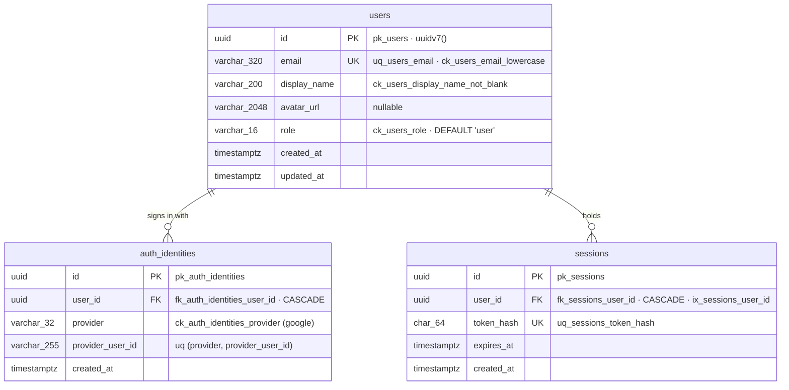

# User, Google auth and role-based access control: design

**Status:** design for branch `feat/build-user-auth-and-rbac` (2026-10-14). Owner brief: Google-only login, three roles, editor ownership, admin editor management. Frozen once merged; living docs carry the result.

## 1. Outcome

A visitor signs in with Google. The API validates the Google identity, creates or updates a local user, and opens a XuanCreative session in an HttpOnly cookie. The frontend calls `GET /auth/me` and routes by `role` (`user` → home; `editor`/`admin` → dashboard). Authorization is enforced by the API through reusable guards, decorators and an ownership policy. Admins promote users to editor and demote editors back to user.

**In scope:** users, Google sign-in, sessions, logout, current user, roles, global default-deny guard, CSRF enforcement, ownership policy primitive, admin editor management, initial admin bootstrap, config, migrations, docs, OpenAPI, tests.
**Out of scope:** Facebook, passwords, magic links, account linking, blog CMS, comments, courses, payments, enrollments, service applications, bookings, refresh tokens, rate limiting (still a launch gate, D23).

## 2. Decisions and trade-offs

| # | Decision | Rejected alternative | Why |
|---|---|---|---|
| A1 | **Opaque server-side sessions**: a random 256-bit token in an HttpOnly cookie; only its SHA-256 is stored in `sessions` | JWT access + refresh cookies (xuan-web §7 expectation) | Revocation (logout, demotion) is immediate and simple; no refresh endpoint, rotation or JWT secret; one indexed lookup per request is cheap at this scale. Roles are read from `users` on every request, so a demotion takes effect at once |
| A2 | **Google Authorization Code flow with PKCE (S256), `state` and `nonce`**, using `google-auth-library` (`OAuth2Client`): server-side code exchange, ID-token verification (signature, `aud`, `iss`, `exp`), then `nonce` and `email_verified` checks | `passport-google-oauth20`; implicit flow; using Google's access token as the app session | The official library verifies ID tokens; Passport adds a framework and its state store needs sessions. Google tokens are never stored or returned |
| A3 | **One module `modules/users/`** owns `users`, `auth_identities`, `sessions`, the auth controller and the admin users controller | Separate `users` and `auth` modules | Their tables reference each other; one owner avoids cross-module ORM relations (C12) and a module cycle (the guard needs sessions and users; admin routes need the guard) |
| A4 | **Auth metadata lives in `src/http/auth/`**: `@Public()`, `@Roles()`, `@CurrentUser()`, `AuthenticatedUser`, `Role`, the ownership policy and the CSRF guard. The session-resolving `AccessGuard` lives in `modules/users/` and is registered as `APP_GUARD` | Decorators inside the users module | Every module (Services now, Blog later) needs the decorators; `http/` may be imported by any module, while importing another module's files is forbidden (I2) |
| A5 | **Default deny**: the global `AccessGuard` requires a valid session unless the route or controller is `@Public()` | Opt-in `@UseGuards` per route | A forgotten decorator fails closed (401), never open |
| A6 | **One role per user**, a `role` column with a CHECK (`user`/`editor`/`admin`) | `roles`/`user_roles` tables; permissions tables | The hierarchy is total and small; multi-role adds nothing now. Settles `data-model.md` §4's open storage question |
| A7 | **Explicit role lists**, e.g. `@Roles('editor', 'admin')`, no numeric ranks | `role >= EDITOR` | Readable at the route; no hidden ordering |
| A8 | **Identity key = (`provider`, `provider_user_id`)** (Google `sub`) in `auth_identities`; `users` holds no provider fields | Google columns on `users` | Facebook later adds rows, not columns |
| A9 | **No silent account linking.** A new Google identity whose verified email already belongs to another user is refused (`ACCOUNT_CONFLICT`) | Link by email | Linking by email alone lets whoever controls an email at another provider take over the account |
| A10 | **Profile sync on every Google login** (email, display name, avatar) while no profile editing exists | Copy only on creation | Google is the only profile source in V1. When profile editing arrives, sync becomes "fill only if empty" (recorded as its trigger) |
| A11 | **Initial admin bootstrap by allowlist** `AUTH_ADMIN_EMAILS`: a successful login with a Google-**verified** email on the list sets `role = admin` (creation or later login). Removal from the list never demotes | First user becomes admin; a CLI command | Deterministic, owner-controlled, no extra tool. Never demoting avoids locking the only admin out by a config typo |
| A12 | **Editor management only moves `user ↔ editor`**: `PUT /admin/editors/:userId`, `DELETE /admin/editors/:userId`. An `admin` target is `409 ADMIN_ROLE_LOCKED`; no API grants or removes `admin` | Generic `PATCH /admin/users/:id/role` | A generic role field invites escalation and self-demotion bugs; two verbs with one rule are easy to test |
| A13 | **CSRF enforcement**: every state-changing request (POST/PUT/PATCH/DELETE) needs `X-Requested-With: XMLHttpRequest`, and an `Origin` header, when present, must be an allowed CORS origin; else `403 FORBIDDEN` | Token-based CSRF | Implements `api-contract.md` §8 as designed: the header forces a preflight; `Origin` validation stops allowed-cookie cross-origin writes |
| A14 | **`GET /auth/me`** for the current user | `GET /users/me` (old xuan-web expectation) | The owner's brief names `/auth/me`; recorded as a xuan-web mirror delta |

## 3. Data model (physical map in `database.md` §12)

- `users.updated_at` exists because profile sync and role changes mutate rows (D27).
- `uq_auth_identities_user_id_provider`: one identity per provider per user (also serves the FK index).
- One migration, `CreateUsersAndAuth`: one logical change ("accounts can sign in"), the three tables only make sense together.
- **Future FKs** point at `users.id`: `content_posts.author_id`, `service_applications.user_id` (nullable, guests apply too), `appointments` via the application, `orders.user_id`, `enrollments.user_id`. Application and booking records **snapshot** the submitted name/email (business history), while `users` stays the live profile used for prefill.

## 4. Flows

### Sign-in
1. `GET /auth/google?returnTo=/path` (`@Public`). `returnTo` is optional, ≤ 512 chars, a relative path: starts with `/`, not `//`, no `\`, no whitespace or control characters. Anything else → `400 VALIDATION_FAILED`.
2. The API creates `state`, `nonce` and a PKCE verifier, stores `{state, nonce, verifier, returnTo, exp}` in a **signed** HttpOnly cookie `xc_oauth` (`Path=/auth/google`, `Max-Age=600`, `SameSite=Lax`, `Secure` per config), and redirects (302) to Google with `scope=openid email profile`, `code_challenge_method=S256`, `prompt=select_account`.
3. `GET /auth/google/callback?code&state` (`@Public`, excluded from OpenAPI). It clears `xc_oauth`, then requires: a valid signature, not expired, `state` equal (constant-time), no `error` parameter, a successful code exchange, a verified ID token whose `nonce` matches, and `email_verified = true`.
4. `UsersService.signInWithGoogle(identity)` in one transaction (C3, I8):
   - identity known → sync the profile, apply the admin allowlist;
   - unknown and the email is free → create the user (`user`, or `admin` if allowlisted) and the identity;
   - unknown and the email belongs to another user → `ACCOUNT_CONFLICT`;
   - a profile sync that would take another user's email → `ACCOUNT_CONFLICT`;
   - concurrent first sign-ins: a unique violation on the identity or email is retried once as a lookup (D11).
5. The API deletes the session named by any incoming `xc_session` cookie (session fixation), creates a new session, sets `xc_session` (`HttpOnly; SameSite=Lax; Path=/; Max-Age=TTL`; `Secure` per config; host-only) and redirects to `AUTH_WEB_URL + returnTo` (default `/`).
6. Any failure redirects to `AUTH_WEB_URL/login?authError=<CODE>`, with `CODE` ∈ `GOOGLE_SIGN_IN_FAILED`, `EMAIL_NOT_VERIFIED`, `ACCOUNT_CONFLICT`. Logged at warn level with the error **name** only (no tokens, codes or URLs).

The callback is the one GET that changes state; it's protected by the signed, single-use `state` + PKCE + `nonce`. Redirect targets are always `AUTH_WEB_URL` (validated config) plus a validated path, so there is no open redirect.

### Requests
`AccessGuard` (global): read `xc_session` → hash → `sessions` row joined to its user. Missing, unknown, malformed or expired (expired rows are deleted) → `401 UNAUTHENTICATED` unless the route is `@Public()`. On success `request.user = { id, role }`. `@Roles(...)`: role not listed → `403 FORBIDDEN`. Never 500 for bad cookies.

### Logout
`POST /auth/logout` (`@Public`, CSRF-checked): delete the current session if any, clear `xc_session`, `204`. Idempotent.

## 5. Authorization

| Capability | user | editor | admin |
|---|---|---|---|
| Sign in/out, `GET /auth/me` | ✓ | ✓ | ✓ |
| Dashboard area (FE) | ✗ | ✓ | ✓ |
| Create a post (future) | ✗ | ✓ (author) | ✓ |
| Edit / publish / unpublish / delete **own** post | ✗ | ✓ | ✓ |
| Same on **another author's** post | ✗ | ✗ (403) | ✓ |
| Manage editors | ✗ | ✗ | ✓ |
| Grant/remove `admin` | ✗ | ✗ | ✗ (bootstrap or owner DB procedure only) |

**Ownership primitive** (`src/http/auth/ownership.ts`): `canManageOwnedResource(actor, ownerId)` = admin → true; editor → `actor.id === ownerId`; otherwise false. `assertCanManageOwnedResource` throws `AppError(FORBIDDEN)`. Future modules load the record, then call it (role check by `@Roles`, ownership in the service). No blog exists, so it's proven by unit tests and a test-only fixture resource. This settles the open "editor publish permission" question in `data-model.md`: editors publish and delete their **own** posts.

## 6. HTTP contract

| Endpoint | Access | Success | Errors |
|---|---|---|---|
| `GET /auth/google` | public | 302 to Google | 400, 500 |
| `GET /auth/google/callback` | public, not in OpenAPI | 302 to the web app | — (failures redirect) |
| `GET /auth/me` | session | `{ data: CurrentUserDto }` | 401, 500 |
| `POST /auth/logout` | public | 204 | 403 (CSRF), 500 |
| `GET /admin/users?role=` | admin | `{ data: AdminUserDto[] }` ordered by `created_at`, `id`; unpaginated V1 (small, admin-only audience; pagination when the first list needs it, §15) | 400, 401, 403, 500 |
| `PUT /admin/editors/:userId` | admin | `{ data: AdminUserDto }` (idempotent) | 400, 401, 403, 404, 409 `ADMIN_ROLE_LOCKED`, 500 |
| `DELETE /admin/editors/:userId` | admin | 204 (idempotent) | 400, 401, 403, 404, 409 `ADMIN_ROLE_LOCKED`, 500 |

- `CurrentUserDto = { id, email, displayName, avatarUrl: string | null, role: 'user' | 'editor' | 'admin' }`.
- `AdminUserDto = CurrentUserDto & { createdAt }`.
- New baseline codes: `UNAUTHENTICATED` (401), `FORBIDDEN` (403). New module code: `ADMIN_ROLE_LOCKED` (409).
- Every non-public route documents 401; every state-changing route documents 403; an OpenAPI test enforces both (I18).
- Role changes use a conditional `UPDATE … WHERE role <> 'admin' RETURNING`, so a race can't touch an admin.

## 7. Config (`src/config/` only, I4)

| Variable | Rule |
|---|---|
| `GOOGLE_CLIENT_ID`, `GOOGLE_CLIENT_SECRET` | required, non-empty |
| `GOOGLE_CALLBACK_URL` | URL; `https` in production |
| `AUTH_WEB_URL` | an origin (no path) that is one of `CORS_ORIGINS` |
| `AUTH_COOKIE_SECRET` | ≥ 32 chars (signs the OAuth state cookie) |
| `AUTH_COOKIE_SECURE` | boolean, default `true`; must be `true` in production |
| `AUTH_SESSION_TTL_DAYS` | integer 1–90, default 14 |
| `AUTH_ADMIN_EMAILS` | comma list of emails, lowercased; default empty |

Errors name variables only (I5). Real values stay in git-ignored `.env` files.

## 8. Testing

- **Unit:** ownership policy; `returnTo` rule; config refinements; OAuth state cookie codec (signature, expiry); Google adapter's authorization URL (no network); profile mapping (display-name fallback, avatar length).
- **E2E (real `xuan_test`, fake Google gateway injected by `createTestApp`; never live Google):** sign-in creates/reuses users, profile sync, bootstrap admin, unverified email, account conflict, bad state/expired/missing cookie, `error` from Google, session fixation, logout, `/auth/me` exact bodies and 401s (no cookie, garbage cookie, expired session), role matrix through fixture routes, ownership through a fixture resource, admin editor management (promote, demote, idempotency, 404, 400, 409, non-admin 403, demotion takes effect immediately), CSRF (missing header, foreign `Origin`), schema invariants (uniques, CHECKs, FK cascade), OpenAPI coverage.
- Live Google is verified manually once the owner configures credentials.

## 9. Future Facebook

Add `facebook` to `ck_auth_identities_provider`, a `FacebookIdentityGateway`, and two routes. A **new** Facebook identity whose email matches an existing user is refused, exactly like Google (A9). Linking is an explicit, authenticated action: the signed-in user starts "connect Facebook", and the callback attaches the identity to `request.user`. Never by email match alone.
